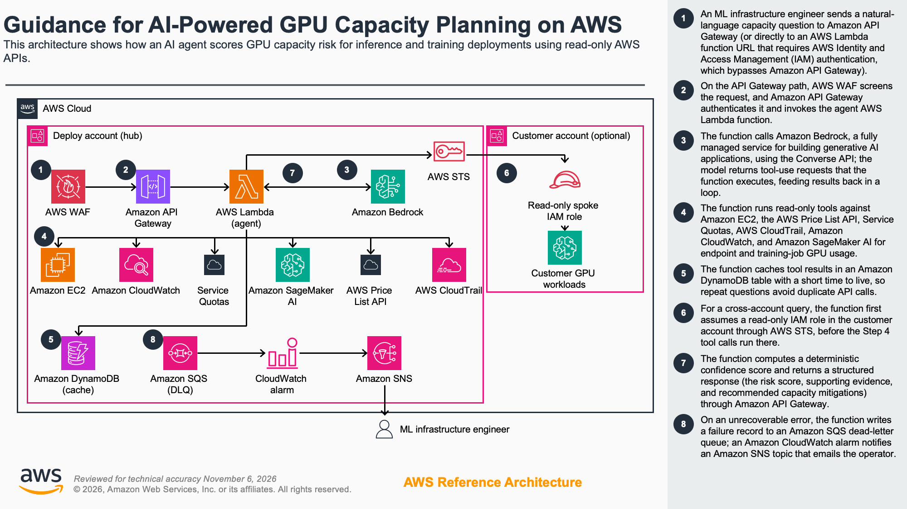

# Guidance for AI-Powered GPU Capacity Planning on AWS

> **Disclaimer:** Before using this solution, you should consider conducting your own independent assessment to ensure that your use would comply with your own specific security and quality control practices and standards, as well as the laws, rules, and regulations that govern you and your content.

An AI agent built on **Amazon Bedrock** that performs **capacity risk assessment** for GPU inference and training workloads on Amazon SageMaker AI and Amazon EC2. It thinks like a senior capacity planner, not just checking data, but scoring deployment confidence deterministically and recommending capacity strategies.

**Deployment pattern agnostic.** The agent handles SageMaker AI managed endpoints and self-managed Amazon EC2 fleets in a single query shape. The CloudTrail Insufficient Capacity Error (ICE) history signal catches capacity failures regardless of the launcher, because they all land on the same `RunInstances` events. `get_ec2_pricing` returns the same hourly rate whether the instance runs under SageMaker AI or self-managed on EC2.

This Guidance is model-agnostic on Amazon Bedrock (Anthropic Claude, Amazon Nova, Meta Llama, Mistral, OpenAI on Bedrock, default is Claude Haiku 4.5 via US cross-region inference, with per-request escalation to Sonnet 4.5 or Nova Pro; see [Model selection](#model-selection)). It also includes a regulatory-constraints matrix for AWS GovCloud, FedRAMP, ITAR/EAR, DoD IL-4/5, and sovereign-cloud deployments.

## Problem

When you plan a GPU inference deployment today, you check three to four disconnected data sources by hand: instance availability by region, pricing, service quotas, and alternative instance types. Each exercise takes hours. The quality of the result varies with each engineer's experience, and the final risk call stays subjective and inconsistent.

## Solution

Give the agent a natural-language capacity question and it returns a **risk-scored decision package** in seconds:

```
Input:  "I'm planning 22 g6 instances in af-south-1 for prod inference launching in 2 weeks. What's my risk?"

Output: Confidence: VERY LOW (<0.3)
        Verdict: NOT FEASIBLE, g6 not GA for SageMaker in af-south-1
        Recommendation: Switch to g5 family (A10G), pre-create On-Demand Capacity Reservation (ODCR), open capacity assistance case
```

## Architecture



**How it works:**

1. You send a natural-language capacity question to the Amazon API Gateway REST endpoint, or to the AWS Lambda function URL for queries that run longer than 29 seconds. The function URL requires IAM authentication (`AuthType: AWS_IAM`) and is not fronted by AWS WAF.
2. AWS WAF screens the request, and Amazon API Gateway authenticates it (AWS Identity and Access Management (IAM) or an API key) and invokes the AWS Lambda function that runs the agent.
3. AWS Lambda calls Amazon Bedrock through the Converse API, passing the read-only tool definitions. Amazon Bedrock returns the tools to call. Steps 3 and 4 repeat in a loop until the model has enough signal or the agent reaches its iteration limit.
4. AWS Lambda runs the read-only tools against public AWS APIs: Amazon Elastic Compute Cloud (Amazon EC2) for instance availability, instance types, Spot placement scores, capacity reservations, and Capacity Blocks for ML; the AWS Price List API; Service Quotas; AWS CloudTrail; Amazon CloudWatch; and Amazon SageMaker AI. Independent tools run in parallel.
5. AWS Lambda caches tool results in an Amazon DynamoDB table with a short time to live, so repeated questions avoid duplicate AWS API calls and reduce cost.
6. For a cross-account query, AWS Lambda assumes a read-only IAM role in the customer account through AWS Security Token Service (AWS STS), passing an external ID. In single-account mode, it queries its own account and skips this step.
7. AWS Lambda computes a deterministic confidence score from the raw tool outputs and returns the structured decision package (verdict, signal table, cost projection, alternatives, and recommended capacity mitigations) through Amazon API Gateway.
8. AWS Lambda publishes invocation logs and metrics to Amazon CloudWatch, which backs the operational dashboard and alarms. A failed invocation goes to an Amazon Simple Queue Service (Amazon SQS) dead-letter queue, and a CloudWatch alarm notifies an encrypted Amazon Simple Notification Service (Amazon SNS) topic.

**Diagram sources:** the authoritative diagram is the official Guidance reference-architecture template (`docs/architecture/guidance-architecture.pptx`, to be added), rendered to `assets/images/guidance-architecture.png`. The diagram-as-code draft is [`docs/architecture/architecture-draft.dac.yaml`](docs/architecture/architecture-draft.dac.yaml) (render with `awsdac`), and the numbered callouts are in [`docs/architecture/architecture-steps.md`](docs/architecture/architecture-steps.md).

## Tools (all public AWS APIs)

The agent has 12 read-only tools. By default it queries the deploy account; supply a `customer_context` block on the request and the agent assumes a role in the customer's account and queries that account instead. Customer-side trust policy + inline policy template are in [docs/implementation-guide.md](docs/implementation-guide.md#cross-account-access).

| Tool | API | Purpose |
|------|-----|---------|
| Instance Availability | `ec2.DescribeInstanceTypeOfferings` | Is the instance type offered in this region/Availability Zone (AZ)? |
| SageMaker Pricing | `pricing.GetProducts` (AmazonSageMaker) | Hourly rate for `ml.*` instances |
| EC2 Pricing | `pricing.GetProducts` (AmazonEC2) | Hourly rate for self-managed GPU fleets |
| Service Quotas | `service-quotas.ListServiceQuotas` | What's the current limit? |
| Alternatives | `ec2.DescribeInstanceTypes` | What similar GPU types are available in the region? |
| Spot Placement Score | `ec2.GetSpotPlacementScores` | Live capacity-depth proxy (1-10 score per region/AZ) |
| Existing ODCRs | `ec2.DescribeCapacityReservations` | Customer's existing On-Demand Capacity Reservations (lifts the verdict when reserved capacity covers the ask) |
| Capacity Blocks for ML | `ec2.DescribeCapacityBlockOfferings` | Public Capacity Blocks inventory for ML families (p4d, p5, p5e, p5en, successors), checked before the agent recommends a Capacity Block as a Tier 1 mitigation |
| Heterogeneous endpoint fallback | `ec2.DescribeInstanceTypes` + `DescribeInstanceTypeOfferings` + `pricing.GetProducts` | Ranks primary + fallback instance pairs for a SageMaker [capacity-aware endpoint](https://docs.aws.amazon.com/sagemaker/latest/dg/realtime-endpoints-heterogeneous.html). Returns a composite pairing score (vendor match + memory fit + cost delta), per-pool tensor-parallelism recommendation (when model size supplied), and a ready-to-paste `ProductionVariants` config. SageMaker inference only. |
| ICE (Insufficient Capacity Error) metrics | `cloudwatch.GetMetricStatistics` on `GPUCapacityAgent/CustomerICE` | Precise, retrospective count of customer capacity errors (requires the companion metric-filter stack, otherwise falls back to ICE history) |
| ICE history | `cloudtrail.LookupEvents` | Customer's recent Insufficient Capacity Errors (last 30 days), fallback for when ICE metrics has no signal, ground-truth capacity signal |
| Reference data | _(local, no API call)_ | GPU chip specs, model sizing, region proximity, served from `src/tools/reference_data.py` to save tokens |

## Testing

| Target | What it runs | Cost |
|---|---|---|
| `make test` | 883 unit tests + coverage threshold (fast, no network) | $0 |
| `make lint` | `ruff check` + `ruff format --check` | $0 |
| `make validate` | `sam validate --lint` on the SAM template | $0 |
| `make ci` | lint + test + validate, the pre-push gate | $0 |
| `make llm-regression` | **Opt-in.** 8 scenarios through real Bedrock Haiku 4.5 with every tool mocked. Verdict-label + narrative-concept + anti-regression assertions. See [`tests/test_llm_regression.py`](tests/test_llm_regression.py) for the scenario list. | **~$0.10/run** |

The LLM regression suite is skipped by default. It only runs when `RUN_LLM_REGRESSION=1` is set in the environment (which `make llm-regression` does for you). Use it after any change that touches `src/agent.py`, `src/config.py` (the system prompt), or the deterministic scorer in `src/confidence.py`.

## Quick start

```bash
# Prerequisites: Python 3.10+, AWS credentials with Bedrock access
cd guidance-for-gpu-capacity-planning-on-aws
python -m venv .venv && source .venv/bin/activate
pip install -r requirements.txt

# Choose a Bedrock model. Default (recommended) is Claude Haiku 4.5 via
# US cross-region inference: fastest & cheapest current-generation
# Anthropic model at $1/M input, $5/M output. Callers can escalate to
# Sonnet 4.5 or switch to Nova Pro per query via the ``model_id`` request
# field. See docs/implementation-guide.md "Model selection guide" for
# the full cost/quality/latency matrix.
export BEDROCK_MODEL_ID="us.anthropic.claude-haiku-4-5-20251001-v1:0"
export AWS_REGION="us-west-2"

# Run a scenario
python examples/agent_demo.py feasible   # Happy path
python examples/agent_demo.py blocked    # Instance not in region
python examples/agent_demo.py quota      # Quota exceeded
python examples/agent_demo.py pricing    # Multi-region comparison
```

## Demo scenarios

| Scenario | What it demonstrates |
|----------|---------------------|
| Model deployment | "Deploy Mistral 7B in us-west-2" → GPU chip guidance, model sizing, cost comparison |
| New region risk | "22 g6 in af-south-1, launching in 2 weeks" → NOT FEASIBLE, g6 not GA, recommends g5 + ODCR |
| Large fleet adversarial | "175 g5.2xl + 100 g5.4xl in sa-east-1, LGPD (Lei Geral de Proteção de Dados, Brazil's data-protection law) constraint" → VERY LOW confidence, quota gap, escalation path |
| Simple feasibility | "20 g5.2xlarge in us-east-1" → DEPLOYABLE, all signals green |

## Model selection

The agent supports **runtime model selection**, the caller picks a model per query from the deployment's allowlist. Requests without a `model_id` field use the stack default (Haiku 4.5). This lets you keep everyday cost low while reserving Sonnet 4.5 for the hardest calls, without redeploying.

### Cost and capability matrix

**Estimated monthly cost: ~$17/mo at the low end (baseline infra floor, zero traffic) to ~$52/mo at steady state (100 queries/day on Haiku 4.5, the default model).**

Rates below are on-demand pricing as of Jul 2026. Actual monthly cost depends on your traffic mix, the "100 q/day" column assumes ~15M total tokens/month at a 70/30 input/output split. Add ~$17/mo for the guidance's infra floor (WAF + Dashboard + CloudWatch + Secrets Manager, see [docs/implementation-guide.md#per-invocation-cost-breakdown](docs/implementation-guide.md#per-invocation-cost-breakdown) for line items). Anthropic Claude 4.x models on Bedrock only ship via Geo Cross Region Inference profiles, the `us.` prefix is mandatory for us-east-1 callers and adds a 10% premium over single-region on-demand rates. Full pricing at [Amazon Bedrock pricing](https://aws.amazon.com/bedrock/pricing/). Live interactive estimate: [AWS Pricing Calculator](https://calculator.aws/#/estimate?id=a5f317004c689a5208a185121779f953a296ad3b).

| Model | Rate ($/M in / out)¹ | 100 q/day LLM cost | Total (LLM + infra) | Best for |
|-------|--------------------|--------------------|-------------------|----------|
| **Haiku 4.5** *(default)* | $1.10 / $5.50 | ~$35/mo | **~$52/mo** | Everyday queries, quick lookups, cost-conscious deployments |
| **Sonnet 4.5** | $3.30 / $16.50 | ~$105/mo | ~$121/mo | Complex multi-region tradeoffs, adversarial fleet asks, deep reasoning |
| **Nova Pro** | $0.80 / $3.20 | ~$22/mo | ~$39/mo | Workshop sandboxes, Amazon-family preference, blocked-Marketplace environments |
| **Nova Lite** | $0.06 / $0.24 | ~$2/mo | ~$19/mo | 1-2 tool lookups when the caller knows the ask is simple |
| **Nova Micro** | $0.035 / $0.14 | ~$1/mo | ~$18/mo | Simple feasibility checks only; weakest tool-use reasoning |

¹ Anthropic Claude rates shown include the 10% Geo Cross Region Inference premium (what you actually pay via the `us.*` inference profile). Amazon Nova has cross-region profiles too but at pricing parity, no premium.

**Only Haiku 4.5 is verified-in-sandbox** at an estimated ~$52/mo. The Nova tier figures are projected from Bedrock on-demand pricing, the per-request allowlist pattern makes them available without redeploy if a caller wants to self-select a cheaper tier. Expect Nova Lite / Micro to spiral on complex multi-tool queries; they're best positioned as **per-query downgrades** for callers who know their ask is simple, not as the stack default.

Haiku 4.5 at an estimated ~$52/mo is the recommended steady state. Sonnet 4.5 is available as a per-query escalation. Nova Pro / Lite / Micro live on the allowlist as per-query downgrades for cost-sensitive asks and as fallbacks for Workshop Studio-vended sandboxes that block Anthropic Marketplace subscriptions.

### When to escalate to Sonnet 4.5

Haiku 4.5 handles the vast majority of capacity questions correctly. Reach for Sonnet 4.5 when:

- The ask spans **4+ regions** with different residency / regulatory constraints
- The customer has **negotiated pricing** (Private Pricing Agreement (PPA) / Enterprise Discount Program (EDP) / Savings Plan (SP)) that needs multi-tier arithmetic
- The workload includes **cross-partition** commercial ↔ GovCloud / China concerns
- The initial Haiku response returns `HIGH RISK` or `NOT FEASIBLE` and the customer needs a second, deeper analysis before escalating to AWS Support

### Calling with a specific model

```bash
# Stack default (Haiku 4.5)
./examples/query-quick.sh "Is p4d.24xlarge available in us-east-1?"

# Escalate to Sonnet 4.5 for a hard query
./examples/query-quick.sh --model sonnet "175 g5.2xl + 100 g5.4xl in sa-east-1 with LGPD constraint, options?"

# Nova Pro (Amazon-family, sandbox-safe)
./examples/query-quick.sh --model nova "Deploy Mistral 7B in us-west-2"
```

Direct API call:

```bash
curl -X POST "https://<api-id>.execute-api.<region>.amazonaws.com/Prod/plan" \
  -H "Content-Type: application/json" \
  -H "x-api-key: $API_KEY" \
  -d '{"query": "...", "model_id": "us.anthropic.claude-sonnet-4-5-20250929-v1:0"}'
```

Requests with a `model_id` NOT on `AllowedBedrockModelIds` return HTTP 400 with the allowlist enumerated. This keeps the IAM boundary from being widened via the request path: the operator picks which models are invokable at deploy time, and callers pick from that set per query.

### Changing the allowlist

Override the `AllowedBedrockModelIds` stack parameter at `sam deploy` time. Example:

```bash
sam deploy --parameter-overrides \
  BedrockModelId=us.anthropic.claude-haiku-4-5-20251001-v1:0 \
  AllowedBedrockModelIds="us.anthropic.claude-haiku-4-5-20251001-v1:0,us.anthropic.claude-opus-4-5-20250915-v1:0"
```

The default (`BedrockModelId`) MUST be on the allowlist. The Lambda enforces this at cold start.

### CLI query tools

```bash
# Quick queries via API Gateway (<29s)
./examples/query-quick.sh "Is p4d.24xlarge available in us-east-1?"

# Complex queries via Function URL (up to 180s)
./examples/query.sh "I'm planning 22 g6 instances in af-south-1 for prod. What's my risk?"
```

Run `python examples/demo_recorded.py` for an offline, deterministic walkthrough of the demo scenarios (no AWS credentials or network access required).

## Capacity risk assessment

The agent produces a structured risk assessment for every query. The confidence score is **deterministic**, computed from raw tool outputs in `src/confidence.py`, not narrated by the LLM. Every response includes a `confidence_assessments` array with one entry per `(instance_type, region)` investigated, sorted riskiest-first.

| Component | Description |
|-----------|-------------|
| **Confidence Score** | HIGH (≥0.80), MODERATE (0.50-0.79), MODERATE-LOW (0.30-0.49), VERY LOW (<0.30), deterministic, same inputs → same score |
| **Signals Table** | Availability ✅/❌, Pricing (GA status), Quota vs. ask, ICE history (last 30 days, ground truth), Spot Placement Score, Existing ODCR coverage, Region maturity |
| **Verdict** | DEPLOYABLE / DEPLOYABLE WITH PREPARATION / HIGH RISK / NOT FEASIBLE |
| **Capacity Strategy** | ODCR, Capacity Blocks, phased deployment, AWS Support case, escalation path |
| **Cost Projection** | Hourly, monthly, annual with discount handling (PPA/EDP/SP) |
| **GPU Chip Reference** | g5→A10G, g6→L4, g6e→L40S, g7→RTX PRO 4500 Blackwell, g7e→RTX PRO 6000 Blackwell, p4d→A100, p5→H100 (incl. single-GPU p5.4xlarge), p5e→H200, p6-b200→B200, p6-b300→B300 (Blackwell Ultra) |

### Region maturity model

The agent factors region capacity maturity into risk scoring:
- **Established**: us-east-1, us-west-2, eu-west-1, ap-northeast-1
- **Moderate**: eu-central-1, ap-southeast-1, ca-central-1
- **Limited-capacity**: af-south-1, sa-east-1, ap-south-2, me-south-1

## Amazon Bedrock features used

| Feature | Where |
|---------|-------|
| Converse API + tool use | Provider-neutral orchestration of all 12 read-only tools |
| Multi-step reasoning | Chaining tool results into a coherent decision |
| Structured output | Feasibility verdict, cost tables, recommendations |
| System prompts | Output format control, citation discipline |
| Bedrock Guardrails (opt-in) | Prompt-injection, content, and sensitive-info filtering |
| Cross-region inference profiles | Deploy in any region; call Bedrock via `us.*` / `eu.*` / `apac.*` profiles |

## IAM permissions required

The Lambda execution role is created automatically by the SAM template. This is the full policy granted (kept in sync with `template.yaml`, the source of truth is [docs/implementation-guide.md § IAM setup](docs/implementation-guide.md#iam-setup)):

```json
{
  "Version": "2012-10-17",
  "Statement": [
    {
      "Sid": "BedrockInvokeRegionPinned",
      "Effect": "Allow",
      "Action": ["bedrock:InvokeModel"],
      "Resource": [
        "arn:aws:bedrock:<BedrockRegion>::foundation-model/*",
        "arn:aws:bedrock:<BedrockRegion>:<account-id>:inference-profile/*",
        "arn:aws:bedrock:us-east-1::foundation-model/*",
        "arn:aws:bedrock:us-east-2::foundation-model/*",
        "arn:aws:bedrock:us-west-2::foundation-model/*",
        "arn:aws:bedrock:eu-west-1::foundation-model/*",
        "arn:aws:bedrock:eu-central-1::foundation-model/*",
        "arn:aws:bedrock:eu-west-3::foundation-model/*",
        "arn:aws:bedrock:ap-northeast-1::foundation-model/*",
        "arn:aws:bedrock:ap-southeast-1::foundation-model/*",
        "arn:aws:bedrock:ap-southeast-2::foundation-model/*"
      ],
      "Condition": "attached when BedrockInvokeScope=RegionPinned (default). The extra US/EU/APAC region ARNs support cross-region inference profiles (us.*/eu.*/apac.*)."
    },
    {
      "Sid": "BedrockInvokeBroad",
      "Effect": "Allow",
      "Action": ["bedrock:InvokeModel"],
      "Resource": [
        "arn:aws:bedrock:*::foundation-model/*",
        "arn:aws:bedrock:*:<account-id>:inference-profile/*"
      ],
      "Condition": "attached only when BedrockInvokeScope=Broad (dev/exploration only)"
    },
    {
      "Sid": "BedrockGuardrailApply",
      "Effect": "Allow",
      "Action": ["bedrock:ApplyGuardrail"],
      "Resource": "arn:aws:bedrock:*:<account-id>:guardrail/<guardrail-id>",
      "Condition": "attached only when BedrockGuardrailId parameter is set"
    },
    {
      "Sid": "EC2Describe",
      "Effect": "Allow",
      "Action": [
        "ec2:DescribeInstanceTypeOfferings",
        "ec2:DescribeInstanceTypes",
        "ec2:GetSpotPlacementScores",
        "ec2:DescribeCapacityReservations",
        "ec2:DescribeCapacityBlockOfferings"
      ],
      "Resource": "*"
    },
    {
      "Sid": "CloudTrailRead",
      "Effect": "Allow",
      "Action": ["cloudtrail:LookupEvents"],
      "Resource": "*"
    },
    {
      "Sid": "CloudWatchMetricsRead",
      "Effect": "Allow",
      "Action": ["cloudwatch:GetMetricStatistics"],
      "Resource": "*"
    },
    {
      "Sid": "SageMakerDescribeRead",
      "Effect": "Allow",
      "Action": ["sagemaker:DescribeEndpointConfig", "sagemaker:SearchTrainingPlanOfferings"],
      "Resource": "*"
    },
    {
      "Sid": "PricingRead",
      "Effect": "Allow",
      "Action": ["pricing:GetProducts"],
      "Resource": "*"
    },
    {
      "Sid": "ServiceQuotasRead",
      "Effect": "Allow",
      "Action": ["servicequotas:ListServiceQuotas"],
      "Resource": "*"
    },
    {
      "Sid": "XRayWrite",
      "Effect": "Allow",
      "Action": ["xray:PutTraceSegments", "xray:PutTelemetryRecords"],
      "Resource": "*"
    },
    {
      "Sid": "SecretsManagerRead",
      "Effect": "Allow",
      "Action": ["secretsmanager:GetSecretValue"],
      "Resource": "<agent-secret-arn>"
    },
    {
      "Sid": "DynamoDBCacheAccess",
      "Effect": "Allow",
      "Action": ["dynamodb:GetItem", "dynamodb:PutItem", "dynamodb:DeleteItem"],
      "Resource": "<tool-cache-table-arn>"
    },
    {
      "Sid": "AssumeCustomerRole",
      "Effect": "Allow",
      "Action": ["sts:AssumeRole"],
      "Resource": "<AllowedCustomerRoleArnPattern>",
      "Condition": "attached only when AllowedCustomerRoleArnPattern is set"
    }
  ]
}
```

**Notes:**
- Bedrock, EC2 read, CloudTrail read, Pricing, and Service Quotas actions cannot be scoped to specific resources (AWS API limitation). Secrets Manager and DynamoDB are scoped to the stack-managed resources.
- The BedrockGuardrailApply and AssumeCustomerRole statements are conditional, they only exist in the deployed role when the corresponding parameter is set.
- The Bedrock wildcard resource lets the Lambda invoke any model; if your security review requires tighter scope, override it in a stack update, see [docs/implementation-guide.md § IAM Setup](docs/implementation-guide.md#iam-setup) for the pattern.

## Well-Architected alignment

Full pillar-by-pillar mapping with design-decision attribution:
[docs/waf-pillar-mapping.md](docs/waf-pillar-mapping.md). Summary:

| Pillar | How this solution aligns |
|--------|------------------------|
| **Cost Optimization** | Surfaces pricing + alternatives before deployment; prevents over-provisioning |
| **Operational Excellence** | Automates manual research; consistent output format; citation-backed |
| **Reliability** | Checks AZ-level availability; recommends multi-AZ alternatives; retry with backoff |
| **Security** | Read-only APIs only; WAF protection; flexible auth; secrets management |
| **Performance** | Parallel tool calls; DynamoDB result cache; token budget enforcement |
| **Sustainability** | Caching reduces redundant API calls; right-sizing recommendations |

## Cost

**Per-invocation Bedrock cost** (dominant driver, varies by model tier, see [Model Selection Guide](docs/implementation-guide.md#model-selection-guide)):

- **Simple query** (1-2 tools, ~3K tokens): $0.005 (Nova Lite), $0.02 (Sonnet 4.5), $0.05 (Opus)
- **Complex query** (4-8 tools, ~15K tokens): $0.03, $0.10, $0.30
- **Adversarial query** (12+ tools, ~40K tokens): $0.10, $0.30, $1.00

**Prompt caching** is on by default (`BEDROCK_PROMPT_CACHE_TTL=5m`) on supported models (Anthropic Claude 3.5+/4.x, Amazon Nova). Two caches run together: the system prompt + 12 tool definitions get cached across requests, and within each multi-iteration tool-use loop the growing conversation history is cached across iterations. Cached tokens read at ~10% of normal input rate, roughly a 30-50% reduction in cumulative Bedrock input-token cost at steady traffic. See [docs/implementation-guide.md § Prompt Caching](docs/implementation-guide.md#prompt-caching) for the full economics and the `"1h"` / `"off"` tuning knobs.

**Per-invocation infrastructure cost** (added to Bedrock cost above):

| Service | Rate | Per 10s invocation |
|---------|------|---------------------|
| Lambda compute (512MB) | ~$0.0000083 / GB-s | ~$0.00004 |
| API Gateway REST | $3.50 / M requests | $0.0000035 |
| DynamoDB (cache) | PAY_PER_REQUEST, ~$0.25 / M writes | ~$0.0000002 |
| Amazon SQS Dead Letter Queue (DLQ), idle | $0 (free tier covers first 1M req/mo) | $0 |
| CloudWatch Logs ingestion | $0.50 / GB | ~$0.000003 per 5 KB log line |
| X-Ray traces | $5 / M after first 100K free | ~$0.000005 |

Total estimated infrastructure ~$0.0003 per invocation, negligible next to Bedrock.

**Monthly fixed cost** (regardless of invocation volume):

| Item | Rate | Monthly |
|------|------|---------|
| WAF WebACL | $5 / month + $1 / rule / month × 3 billable rules (1 standalone + 2 managed rule groups) + ~$0.60 request processing | $8.60 |
| CloudWatch Metrics (20 custom, 10 after free tier) | $0.30 / metric / month | $3.00 |
| CloudWatch Logs ingested + storage (1 GB) | $0.50 / GB ingestion + $0.03 / GB storage | $0.53 |
| CloudWatch alarms (7 standard-resolution) | $0.10 / alarm / month | $0.70 |
| CloudWatch dashboard | $3 / dashboard / month | $3.00 |
| CloudWatch API requests (ListMetrics, GetMetricData, etc.) | $0.01 / 1,000 requests | $0.07 |
| SNS topic (if using email subscription) | first 1000 emails free | $0 |
| Secrets Manager | $0.40 / secret / month | $0.40 |

**Estimated baseline monthly floor** (zero traffic): ~$17.

**Interactive pricing estimate:** [calculator.aws link](https://calculator.aws/#/estimate?id=a5f317004c689a5208a185121779f953a296ad3b), an estimated ~$52/mo at the 100 q/day reference workload on Haiku 4.5. The biggest lever is model choice; the second-biggest is your `TOKEN_BUDGET` env var (default 80K per invocation).

## Project structure

```
src/
├── agent.py                    # Bedrock Converse + tool-use loop
├── config.py                   # Model ID, region, system prompt
├── lambda_handler.py           # Lambda entry point with validation pipeline
├── metrics.py                  # Custom Embedded Metric Format (EMF) metrics (tool duration, success/failure)
├── retry_handler.py            # Exponential backoff with jitter
├── secrets_manager.py          # Secrets Manager with cold-start caching
├── tool_cache.py               # DynamoDB tool result cache (TTL, size guard)
├── tools/
│   ├── instance_availability.py  # EC2 DescribeInstanceTypeOfferings
│   ├── pricing.py               # AWS Pricing API
│   ├── service_quotas.py        # Service Quotas API
│   └── alternatives.py          # Instance similarity scoring
└── output/                     # Output formatters (v2)

tests/
├── conftest.py                 # Shared fixtures
├── test_agent.py               # Agent loop unit tests
├── test_agent_property.py      # Property-based agent tests
├── test_agent_error_result_property.py
├── test_agent_timeout_property.py
├── test_lambda_handler.py      # Handler unit tests
├── test_lambda_handler_property.py
├── test_metrics.py             # Metrics unit tests
├── test_metrics_property.py
├── test_retry_handler.py       # Retry logic unit tests
├── test_retry_handler_property.py
├── test_secrets.py             # Secrets manager tests
├── test_tool_cache.py          # Cache unit tests
├── test_tool_cache_property.py
├── test_token_budget_property.py
├── test_graceful_degradation_property.py
├── test_integration.py         # Integration tests (deployed endpoint)
├── test_integration_e2e.py     # End-to-end integration tests
└── test_tools/                 # Tool module unit + property tests
```

## Development

```bash
# Setup
python -m venv .venv && source .venv/bin/activate
pip install -r requirements.txt
pip install -r requirements-dev.txt

# Run tests (unit + property tests, excludes integration)
make test

# Run full local CI (lint + test + SAM validate)
make ci

# Run integration tests against a deployed endpoint
INTEGRATION_TEST_URL=https://xxx.execute-api.us-west-2.amazonaws.com/Prod/plan \
  pytest tests/test_integration.py -m integration -v

# Format and lint
make format
make lint
```

The `make` targets above (and the `Makefile`) cover local development. See the repository [CONTRIBUTING.md](../../CONTRIBUTING.md) for contribution guidelines.

## Deployment

### One-click deploy

For a fresh AWS account (recommended for evaluation), the repository ships
a single script that handles every account-level pre-requisite (API
Gateway CloudWatch Logs role, Bedrock model access check), clones the
code, and runs `sam build && sam deploy`:

```bash
./deployment/deploy.sh
```

The script produces a uniquely-named CloudFormation stack (`gpu-capacity-agent-<timestamp>`) and prints the API endpoint, Function URL, and API key on completion.

The script is intended for **Amazon Linux 2023** (the AWS Solutions Library sample-code validation environment). On macOS or Windows, use the manual `make deploy` path documented below.

Tear the deployment down with:

```bash
./deployment/cleanup.sh <stack-name>
```

See [`deployment/deploy.sh`](deployment/deploy.sh) for parameter defaults and inline documentation of each step.

### Manual `sam deploy`

```bash
# Build and deploy (guided first time)
make build
make deploy

# Subsequent deploys with saved config
sam deploy

# With all parameters
sam deploy --parameter-overrides \
  BedrockModelId=us.anthropic.claude-haiku-4-5-20251001-v1:0 \
  AllowedBedrockModelIds="us.anthropic.claude-haiku-4-5-20251001-v1:0,us.anthropic.claude-sonnet-4-5-20250929-v1:0,us.amazon.nova-pro-v1:0" \
  BedrockRegion=us-west-2 \
  AuthMethod=API_KEY \
  AlarmNotificationTopicArn=arn:aws:sns:us-east-1:123456789012:my-topic \
  WafRateLimit=100 \
  GeoBlockCountries="CN,RU,KP" \
  BedrockGuardrailId=abc12def34gh \
  EnableFunctionUrl=false
```

### SAM parameters

| Parameter | Default | Description |
|-----------|---------|-------------|
| `BedrockModelId` | `us.anthropic.claude-haiku-4-5-20251001-v1:0` | Default Bedrock model / inference-profile ID (used when the request omits `model_id`) |
| `AllowedBedrockModelIds` | Haiku 4.5 + Sonnet 4.5 + Nova Pro (comma-separated) | Allowlist of model IDs callers may request per query via the `model_id` request-body field. Requests with a `model_id` outside this list get a 400. |
| `BedrockRegion` | `us-west-2` | Region where the model / inference profile is available |
| `ReservedConcurrency` | `50` | Max concurrent Lambda executions. Sized so a full-tenure attack (all slots × 180s Function URL timeout) exhausts in ~3 min. Lower it to shed load earlier; raise for higher throughput (subject to account limit). |
| `LogEncryptionKeyArn` | _(empty)_ | Optional KMS key ARN for CloudWatch log encryption |
| `AlarmNotificationTopicArn` | _(required)_ | SNS topic ARN for CloudWatch alarm notifications |
| `AuthMethod` | `IAM` | Authentication method: `IAM` or `API_KEY` |
| `WafRateLimit` | `100` | Max requests per 5-min window per IP before WAF blocks |
| `GeoBlockCountries` | _(empty)_ | Comma-separated ISO country codes to block (e.g., `CN,RU,KP`) |
| `BedrockGuardrailId` | _(empty)_ | Bedrock Guardrail ID for prompt-injection / content filtering (recommended for internet-exposed deployments) |
| `BedrockGuardrailVersion` | `DRAFT` | Guardrail version (`DRAFT` during iteration, numeric in production) |
| `EnableFunctionUrl` | `false` | Enable the Function URL for long-running queries. **Bypasses WAF**, enable only when IAM is your sole trust boundary. |
| `AllowedCustomerRoleArnPattern` | _(empty)_ | Cross-account IAM role ARN pattern the Lambda may assume via `sts:AssumeRole` (for reading the customer's own quotas / ODCRs / CloudTrail) |
| `BedrockInvokeScope` | `RegionPinned` | IAM scope for `bedrock:InvokeModel`: `RegionPinned` (production default) restricts to `BedrockRegion` + US/EU/APAC inference-profile targets; `Broad` grants the previous any-region wildcard (dev only) |
| `BedrockTokenAlarmThreshold` | `1000000` | Threshold (input+output tokens per 5-min window) that triggers the Bedrock spend alarm. |
| `LogRetentionDays` | `90` | CloudWatch log retention for the Lambda's log group. Raise to 400+ for regulated workloads (FedRAMP High, ITAR, PCI-DSS). Must be a CloudWatch-supported value (1, 3, 5, 7, 14, 30, 60, 90, 120, 150, 180, 365, 400, 545, 731, 1096, 1827, 2192, 2557, 2922, 3288, 3653). |

### Endpoints

The stack always exposes the API Gateway endpoint. The Lambda Function URL is **opt-in** because it bypasses WAF (see below).

| Endpoint | Timeout | Auth | Perimeter | Use Case |
|----------|---------|------|-----------|----------|
| API Gateway (`/plan`) | 29s | IAM / API Key | ✅ WAF (rate limit + geo-block + managed rule sets) | Quick queries (1-2 tools, <10s). Default and recommended. |
| Function URL (opt-in via `EnableFunctionUrl=true`) | 180s | AWS_IAM (SigV4) | ❌ WAF does not front Function URLs | Complex multi-tool queries (30-60s). Enable only when IAM is your sole trust boundary, or front it with CloudFront + regional WAF. |

```bash
# API Gateway: simple queries
curl -X POST "https://<api-id>.execute-api.<region>.amazonaws.com/Prod/plan" \
  -H "Content-Type: application/json" \
  -H "x-api-key: <your-api-key>" \
  -d '{"query": "Can I deploy 20 ml.g5.2xlarge in us-east-1?"}'

# Function URL: complex queries (SigV4-signed; requires EnableFunctionUrl=true)
awscurl --service lambda --region us-east-1 -X POST \
  -H "Content-Type: application/json" \
  -d '{"query": "Compare g5.12xlarge vs p4d.24xlarge across 3 regions for 200 instances"}' \
  "$(aws cloudformation describe-stacks --stack-name <stack> \
     --query 'Stacks[0].Outputs[?OutputKey==`FunctionUrl`].OutputValue' --output text)"
```

### Production features

**Observability**
- CloudWatch Operational Dashboard (invocations, duration percentiles, token usage, tool distribution, DLQ depth)
- CloudWatch Alarms (DLQ messages, error rate >5%, p99 latency >30s, throttles)
- Custom EMF Metrics (per-tool duration and success/failure rates)
- Per-caller usage tracking (structured logs for chargeback)
- X-Ray active tracing

**Resilience**
- Retry with exponential backoff (3 attempts, jitter, retryable error classification)
- Graceful degradation (continues on tool failure, reports partial results)
- DynamoDB tool result cache (configurable TTL, 400KB size guard)
- Dead Letter Queue (14-day retention for failed async invocations)
- Timeout-aware loop control (15s safety margin before Lambda timeout)
- Token budget enforcement (configurable per-invocation cap, default 80K)

**Security**
- WAF protection (rate limiting, geo-blocking, AWS managed rule sets)
- Flexible authentication (IAM / API_KEY via stack parameter; front with CloudFront + Cognito or a custom Lambda authorizer for OpenID Connect (OIDC))
- Secrets Manager with cold-start caching
- Input validation (body size, query length, prompt injection detection)
- Safe error handling (generic 500 responses, no internal detail leakage)
- Optional KMS encryption for CloudWatch logs

**Scaling**
- Reserved concurrency (prevents runaway scaling)
- Lambda Function URL (bypasses API Gateway 29s timeout)

## Known limitations and when not to use

This guidance provides **capacity signals**, not capacity commitments. Read this list before using the output as an input to production automation.

**This is NOT:**

- **A capacity guarantee.** The agent reads public AWS APIs (availability, pricing, quotas, Spot Placement Score) and, when `customer_context` is used, the customer's own ODCRs and CloudTrail. None of these are contractual commitments. AWS Support can promise capacity; this agent cannot. For fleets ≥ 100 instances or deployment decisions ≥ $1M ARR, the "escalate to your AWS account team" recommendation is not optional.
- **A real-time deployment automation tool.** Verdicts age. A "DEPLOYABLE" today can become "NOT FEASIBLE" tomorrow if capacity is drained by another workload. Do not chain this into an auto-deployer, treat it as a decision-support signal that a human reviews before acting.
- **A substitute for AWS Support for large-fleet capacity requests.** For strategic deployments the account team + capacity engineering team have visibility this agent doesn't. Use this agent to inform the conversation, not replace it.
- **Model-narrative-as-truth.** The `confidence_assessments[]` array is the auditable, deterministic quantitative record. The LLM's narrative is qualitative explanation. When automating downstream decisions, key off the array's `verdict` and `score`, not the free-text answer, which can drift across model versions.
- **A cost-modeling tool.** The Pricing API returns list prices only; PPA / EDP / Reserved Instance (RI) / SP discounts are user-supplied to the query. It does not know your negotiated rate unless you tell it.

**Known limitations of the underlying signals:**

- **CloudTrail retention**, `get_ice_history` sees up to 90 days back. Older ICE incidents are invisible.
- **Spot Placement Score is a proxy.** It correlates with on-demand capacity but is not a direct measurement. The agent already treats customer-side ICE events as ground truth over the Spot Placement Score when both are present (see the deterministic scoring hierarchy).
- **`get_sagemaker_quota` matches on quota name substring.** Some legacy account quotas use non-standard names and won't match, the agent then treats them as "quota unknown" (neutral in scoring).
- **Reference data (GPU chip specs, model sizing, region proximity) is baked into `src/tools/reference_data.py`.** Update it when Bedrock GAs a new GPU family or a new region.
- **Cross-region inference profiles.** The Bedrock IAM scope granted by default (`BedrockInvokeScope=RegionPinned`) covers US / EU / APAC inference-profile routing targets. If you use a profile that spans different regions, add those region ARNs to the policy (see [docs/implementation-guide.md § IAM Setup](docs/implementation-guide.md#iam-setup)).

**Regulated deployments** (AWS GovCloud, ITAR, FedRAMP High, DoD IL-4/5, sovereign clouds): review the [Regulatory and data-residency constraints](docs/implementation-guide.md#regulatory-and-data-residency-constraints) matrix before deploying. Cross-partition inference is not supported.

## Security disclaimer

This is sample code, for non-production usage. You should work with your security and legal teams to meet your organizational security, regulatory, and compliance requirements before deployment.

## License

This library is licensed under the MIT-0 License. See the [LICENSE](../../LICENSE) file in the repository root.
