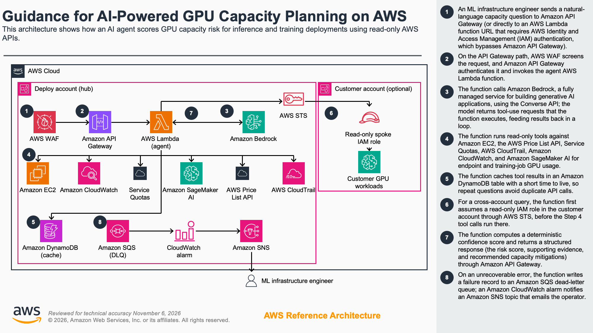

# Implementation Guide: Guidance for AI-Powered GPU Capacity Planning on AWS

> **Disclaimer:** This is sample code, for non-production usage. You should work with your security and legal teams to meet your organizational security, regulatory, and compliance requirements before deployment.

## Overview

This Guidance deploys an AI agent that assesses capacity risk for GPU inference and training workloads on Amazon SageMaker AI and Amazon Elastic Compute Cloud (Amazon EC2). The agent is built on Amazon Bedrock and runs as an AWS Lambda (Lambda) function behind Amazon API Gateway, with an optional Lambda function URL for long-running queries. You ask a natural-language question such as "Can I deploy 20 ml.g5.2xlarge in us-east-1 for inference?", and the agent calls read-only AWS APIs and then scores deployment confidence deterministically rather than relying on the model alone.

The agent reads capacity signals from Amazon EC2, the AWS Price List API, Service Quotas, AWS CloudTrail, and Amazon CloudWatch. It caches results in Amazon DynamoDB, protects its endpoint with AWS WAF, stores its credential in AWS Secrets Manager, and routes failed invocations to an Amazon Simple Queue Service (Amazon SQS) dead-letter queue with Amazon Simple Notification Service (Amazon SNS) alerting.

**Key features**

- Deterministic confidence scoring computed from raw tool outputs, not from the model, so the same inputs always produce the same verdict.
- Twelve read-only tools spanning instance availability, pricing, quotas, Spot placement, On-Demand Capacity Reservations (ODCRs), Capacity Blocks for ML, and capacity-error history.
- Model-agnostic design: any Amazon Bedrock model that supports the Converse API with tool use works, selectable per request from an operator-defined allowlist.
- Optional cross-account reads through an AWS Security Token Service (AWS STS) role, so a central team can assess a workload account.

**Use cases**

- An ML infrastructure engineer checks whether a GPU fleet is feasible in a target AWS Region before committing a deployment.
- A central ML platform team assesses capacity risk across several workload accounts.
- A solutions architect compares instance types and Regions and recommends capacity mitigations, such as ODCRs, Capacity Blocks for ML, Flexible Training Plans, or heterogeneous endpoints.

### Architecture overview

The following diagram shows the reference architecture this Guidance deploys.



### How it works

1. An ML infrastructure engineer sends a natural-language capacity question to Amazon API Gateway, or to an AWS Lambda function URL that requires IAM authentication.
2. AWS WAF screens the request, and Amazon API Gateway authenticates it and invokes the agent AWS Lambda function.
3. The function calls Amazon Bedrock with the Converse API, and the model requests read-only tools in a loop.
4. The function runs read-only tools against Amazon EC2, the AWS Price List API, Service Quotas, AWS CloudTrail, Amazon CloudWatch, and Amazon SageMaker AI.
5. The function caches tool results in an Amazon DynamoDB table with a short time to live, so repeat questions avoid duplicate API calls.
6. For a cross-account query, the function assumes a read-only AWS Identity and Access Management (IAM) role in the customer account through AWS STS.
7. The function computes a deterministic confidence score and returns the structured decision package, with recommended capacity mitigations, through Amazon API Gateway.
8. A failed run goes to an Amazon SQS dead-letter queue, and an Amazon CloudWatch alarm notifies an Amazon SNS topic that emails the operator.

For longer step descriptions and the editable diagram source, see [architecture/architecture-steps.md](architecture/architecture-steps.md).

### Well-Architected alignment

This Guidance follows AWS Well-Architected Framework best practices. For the pillar-by-pillar mapping, see [waf-pillar-mapping.md](waf-pillar-mapping.md). For the security risks, trust boundaries, and a STRIDE threat enumeration, see [threat-model.md](threat-model.md).

### Supported AWS Regions

Deploy this Guidance in any AWS Region where AWS Lambda, Amazon API Gateway, Amazon DynamoDB, AWS WAF, and the read-only AWS APIs the agent calls are available, and where the Amazon Bedrock model you choose is generally available. The deploy Region and the Amazon Bedrock inference Region are decoupled (see [Multi-region deployment](#multi-region-deployment)), so you keep Lambda, logs, and the cache in a Region that meets your data-residency needs while calling a model hosted elsewhere. Confirm current model availability in the [Amazon Bedrock model support by Region table](https://docs.aws.amazon.com/bedrock/latest/userguide/models-regions.html) before you deploy to a new Region.

---

## Prerequisites

- AWS account with Amazon Bedrock access enabled
- Bedrock model access granted for at least one model that supports the Converse API with tool use (default: `us.anthropic.claude-haiku-4-5-20251001-v1:0`). See [Model selection guide](#model-selection-guide) for alternatives, the agent is model-agnostic and supports per-request model selection via the `model_id` request-body field.
- AWS SAM CLI installed (`brew install aws-sam-cli` or [install guide](https://docs.aws.amazon.com/serverless-application-model/latest/developerguide/install-sam-cli.html))
- Python 3.10+
- IAM permissions to deploy Lambda, API Gateway, DynamoDB, SQS, Secrets Manager, WAF, and CloudWatch resources
- An existing SNS topic ARN for alarm notifications (the deployment requires one)
- Optional but recommended for internet-exposed deployments: an Amazon Bedrock Guardrail (any tuned Guardrail ID; pass via `BedrockGuardrailId` parameter)
- For **regulated / government workloads**: know your compliance boundary (AWS GovCloud US, DoD IL-4/5, sovereign cloud, FedRAMP, ITAR/EAR) before choosing `BedrockRegion`, see [Regulatory and data-residency constraints](#regulatory-and-data-residency-constraints)

---

## Step 1: Enable Bedrock model access

1. Open the [Amazon Bedrock console](https://console.aws.amazon.com/bedrock)
2. Navigate to **Model access** in the left sidebar
3. Request access to the models you plan to use. The stack default is Anthropic Claude Haiku 4.5 via the US cross-region inference profile (`us.anthropic.claude-haiku-4-5-20251001-v1:0`), fastest and cheapest current-generation Anthropic model. The default allowlist also includes Claude Sonnet 4.5 (`us.anthropic.claude-sonnet-4-5-20250929-v1:0`) for callers who want stronger reasoning on a per-query basis, and Amazon Nova Pro (`us.amazon.nova-pro-v1:0`) for sandboxes that block Anthropic Marketplace subscriptions. Grant model access for every model on your allowlist. Any Bedrock foundation model that supports the Converse API with `tool_use` can be added to the allowlist, see the [Model selection guide](#model-selection-guide).
4. Wait for access to be granted (typically immediate for on-demand models; some models require an AWS account team review)
5. If you're deploying to **AWS GovCloud (US)** or another sovereign region, confirm the model is GA in that partition **before** requesting access. Model catalogs differ between commercial and government partitions.

---

## Step 2: Deploy the solution

Deploy with the AWS SAM CLI (recommended) or run the agent locally for development. Choose one of the two options below.

### Option A: SAM deployment (recommended)

```bash
# Clone the repository
git clone https://github.com/aws-solutions-library-samples/guidance-for-gpu-capacity-planning-on-aws.git
cd guidance-for-gpu-capacity-planning-on-aws

# Build and deploy
make build
make deploy   # First-time deployment uses --guided
```

The project ships with a `samconfig.toml` that pins the stack name to `gpu-capacity-agent`. If you accept the defaults, the deployment includes:

| Parameter | Default | Description |
|-----------|---------|-------------|
| `BedrockModelId` | `us.anthropic.claude-haiku-4-5-20251001-v1:0` | Default Bedrock model / inference-profile ID (used when the request omits `model_id`) |
| `AllowedBedrockModelIds` | Haiku 4.5 + Sonnet 4.5 + Nova Pro (comma-separated) | Allowlist of model IDs callers may request per query via the request-body `model_id` field |
| `BedrockRegion` | `us-west-2` | Region where the model / inference profile is available |
| `ReservedConcurrency` | `50` | Maximum concurrent Lambda executions. Lower to shed load; raise for burst capacity (subject to account limit). See "Sizing ReservedConcurrency" below. |
| `LogEncryptionKeyArn` | _(empty)_ | Optional KMS key ARN for CloudWatch log encryption |
| `AlarmNotificationTopicArn` | _(required)_ | SNS topic ARN for alarm notifications |
| `AuthMethod` | `API_KEY` (in samconfig) / `IAM` (template default) | Authentication method: `IAM` or `API_KEY` |
| `WafRateLimit` | `100` | Max requests per 5-min window per source IP |
| `GeoBlockCountries` | _(empty)_ | Comma-separated ISO codes (e.g. `CN,RU,KP`) to block |
| `BedrockGuardrailId` | _(empty)_ | Optional Bedrock Guardrail ID for server-side prompt-injection / content filtering |
| `BedrockGuardrailVersion` | `DRAFT` | Guardrail version (`DRAFT` while iterating, numeric in production) |
| `EnableFunctionUrl` | `false` | Enable the long-running Function URL (bypasses WAF, opt-in) |
| `AllowedCustomerRoleArnPattern` | _(empty)_ | Cross-account role ARN pattern for `sts:AssumeRole` |

> **Note:** `src/config.py`, `template.yaml`, and `samconfig.toml` all agree on the default (`us.anthropic.claude-haiku-4-5-20251001-v1:0`) and the allowlist (Haiku 4.5 + Sonnet 4.5 + Nova Pro). A CI test locks this, see `tests/test_defaults_consistency.py`.

### Option B: Local development

```bash
# Create virtual environment
python -m venv .venv
source .venv/bin/activate  # Linux/Mac
# .venv\Scripts\activate   # Windows

# Install dependencies
pip install -r requirements.txt
pip install -r requirements-dev.txt   # for tests + lint

# Configure
export AWS_REGION=us-west-2
export BEDROCK_MODEL_ID=us.anthropic.claude-haiku-4-5-20251001-v1:0

# Interactive REPL (recommended for exploration)
python examples/chat.py

# Scripted demo scenarios
python examples/agent_demo.py feasible

# Run the test suite
make test
```

The project ships three CLI entrypoints:

| Entry point | Purpose | Best for |
|-------------|---------|----------|
| `examples/chat.py` | Interactive REPL with markdown-stripped output | Exploration, demos, dev iteration |
| `examples/agent_demo.py` | Scripted scenarios (feasible, blocked, quota, pricing, ec2_compare, large_fleet, model_deploy) | Smoke tests, deterministic walk-throughs |
| `examples/query.sh` / `query-quick.sh` | Hit deployed Function URL / API Gateway | Live demos against deployed stack |

---

## Step 3: Test the deployment

The stack exposes two endpoints, optimized for different query complexity:

| Endpoint | Path | Timeout | Auth | Use Case |
|----------|------|---------|------|----------|
| **API Gateway** | `/plan` | 29s | IAM / API_KEY | Quick queries (1-2 tools, <10s) |
| **Lambda Function URL** | _(see stack output `FunctionUrl`)_ | 180s | AWS_IAM (SigV4) | Complex multi-tool queries (30-60s) |

### Via API Gateway (after SAM deploy)

```bash
# Get your API endpoint from SAM outputs
API_URL=$(aws cloudformation describe-stacks \
  --stack-name gpu-capacity-agent \
  --query 'Stacks[0].Outputs[?OutputKey==`ApiEndpoint`].OutputValue' --output text)

# If you deployed with AuthMethod=API_KEY, retrieve the key
API_KEY_ID=$(aws apigateway get-api-keys \
  --query "items[?name=='gpu-capacity-agent-api-key'].id" --output text)
API_KEY=$(aws apigateway get-api-key --api-key "$API_KEY_ID" \
  --include-value --query "value" --output text)

# Quick feasibility query
curl -X POST "$API_URL" \
  -H "Content-Type: application/json" \
  -H "x-api-key: $API_KEY" \
  -d '{"query": "Can I deploy 20 ml.g5.2xlarge in us-east-1 for SageMaker inference?"}'
```

### Via Function URL (for complex queries)

```bash
FUNCTION_URL=$(aws cloudformation describe-stacks \
  --stack-name gpu-capacity-agent \
  --query 'Stacks[0].Outputs[?OutputKey==`FunctionUrl`].OutputValue' --output text)

# Function URL is AWS_IAM auth; sign with SigV4 (awscurl)
awscurl --service lambda --region us-east-1 -X POST \
  -H "Content-Type: application/json" \
  -d '{"query": "Compare g5.12xlarge vs p4d.24xlarge across 3 regions for 200 instances"}' \
  "$FUNCTION_URL"
```

### Expected response structure

```json
{
  "request_id": "abc-123",
  "answer": "## Capacity Risk Assessment\n### Confidence Score\n...",
  "tool_calls": 6,
  "iterations": 5,
  "stop_reason": "end_turn",
  "incomplete": false,
  "usage": {
    "input_tokens": 4200,
    "output_tokens": 1800,
    "total_tokens": 6000,
    "budget_limit": 80000
  },
  "tool_outcomes": {
    "succeeded": ["check_instance_availability", "get_sagemaker_pricing", "check_existing_odcrs"],
    "failed": []
  },
  "confidence_assessments": [
    {
      "instance_type": "g5.2xlarge",
      "region": "af-south-1",
      "requested_count": 22,
      "raw_signals_used": {
        "instance_available": true,
        "pricing_available": true,
        "quota_limit": 2,
        "spot_placement_score": 3,
        "requested_count": 22,
        "odcr_available_capacity": 0
      },
      "confidence": {
        "score": 0.32,
        "label": "MODERATE-LOW",
        "verdict": "HIGH RISK",
        "signals": {
          "availability": 1.0,
          "pricing": 1.0,
          "quota": 0.09,
          "spot_placement": 0.3,
          "region_maturity": 0.3,
          "odcr_coverage": 0.0,
          "ice_history_signal": null
        },
        "weights": { "availability": 0.25, "pricing": 0.15, "quota": 0.25, "spot_placement": 0.25, "region_maturity": 0.10 },
        "base_score": 0.328,
        "applied_caps": []
      }
    }
  ]
}
```

### Deterministic confidence scoring

Every response carries one `confidence_assessments` entry per `(instance_type, region)` the agent investigated. The score is computed **deterministically** from raw tool outputs by `src/signal_extractor.py` + `src/confidence.py`, not by the LLM. Same inputs → same score.

| Signal | Weight | Source tool |
|--------|-------:|-------------|
| Instance available in region | 0.25 | `check_instance_availability` |
| Pricing / GA status | 0.15 | `get_sagemaker_pricing` |
| Quota sufficiency (ratio limit/requested) | 0.25 | `get_sagemaker_quota` |
| Spot Placement Score (proxy for pool depth) | 0.25 | `get_spot_placement_score` |
| Region maturity (per-GPU-family) | 0.10 | `src/region_model.py` |
| ICE history (side signal) |, | `get_ice_history`, real capacity errors in the customer's CloudTrail. Queries RunInstances for EC2-managed targets AND CreateEndpoint / UpdateEndpoint under `eventSource=sagemaker.amazonaws.com` for SageMaker-managed targets (default `deployment_target=auto` runs both). Bands: 0 events no penalty; 1-3 (isolated) caps spot at 0.6; 4-10 (recurring) caps spot at 0.3 AND caps final score at 0.65; 11+ (severe) caps spot at 0.1 AND caps final score at 0.4. **A response with `capacity_signal in {unknown, rate_limited}` or missing entirely triggers the `ice_signal_unavailable` cap, the scorer refuses DEPLOYABLE until real ICE evidence is obtained.** See "ICE-history data-source limits" below for the CloudWatch metric-filter fallback high-volume customers should deploy. |
| ODCR coverage (side signal) |, | `check_existing_odcrs`, lifts the spot-placement signal to at least `available_capacity / requested_count`. A fully-covering ODCR (coverage ≥ 1.0) also defeats the ICE hard cap, since reserved capacity is unaffected by shared-pool ICE. |
| Capacity Blocks availability (side signal) |, | `get_capacity_blocks_offerings`. Tier 1 mitigation inventory check. When offerings are available for the instance type / region, lifts the spot-placement signal to a modest `0.4` floor via the `capacity_blocks_available_lift` cap. Weaker than ODCR (purchasable inventory ≠ reserved capacity), does NOT defeat the ICE severity caps. |
| Flexible Training Plans availability (side signal) |, | `get_sagemaker_training_plan_offerings`. Tier 2 mitigation inventory check. When plans are available for the instance type / region / duration ask, applies the same `0.4` spot-placement floor via the `training_plans_available_lift` cap. Same no-override behavior on ICE caps as the Capacity Blocks lift. |
| Heterogeneous endpoint fallback availability (side signal) |, | `evaluate_heterogeneous_endpoint_fallback`. SageMaker-inference architectural mitigation. When at least one fallback candidate survives the tool's hard disqualifiers (same GPU vendor, offered in region, SageMaker-GA), applies the same `0.4` spot-placement floor via the `heterogeneous_fallback_available_lift` cap. Shared `_MITIGATION_PATH_FLOOR` constant pins the three mitigation-path lifts to the same value. Same no-override behavior on ICE caps. |

Hard gates and final-score ceilings the scorer applies (see also the `applied_caps` audit trail on every response):

| Cap kind | Fires when | Effect |
|----------|------------|--------|
| `hard_gate_unavailable` | Instance type not offered in region | Score capped at 0.10; verdict `NOT FEASIBLE` |
| `hard_gate_not_ga` | No SageMaker pricing for the instance/region | Score capped at 0.20; verdict `NOT FEASIBLE` |
| `sps_ceiling_critical` | Spot Placement Score ≤ 3 AND no fully-covering ODCR | Score capped at 0.40; verdict `HIGH RISK` |
| `ice_ceiling_recurring` | 4-10 ICE events in lookback AND no fully-covering ODCR | Score capped at 0.65; verdict `DEPLOYABLE WITH PREPARATION` |
| `ice_ceiling_severe` | 11+ ICE events in lookback AND no fully-covering ODCR | Score capped at 0.40; verdict `HIGH RISK` |
| `ice_signal_unavailable` | ICE tool never ran OR returned `rate_limited`/`unknown`, AND no fully-covering ODCR | Score capped at 0.65, "not queried" is not "clean" |

Label / verdict mapping (single source of truth, label and verdict come from the same bucket):

| Score band | Label | Verdict |
|-----------:|-------|---------|
| ≥ 0.80 | HIGH | DEPLOYABLE |
| 0.65-0.79 | MODERATE | DEPLOYABLE WITH PREPARATION |
| 0.50-0.64 | MODERATE | DEPLOYABLE WITH PREPARATION |
| 0.30-0.49 | MODERATE-LOW | HIGH RISK |
| < 0.30 | VERY LOW | NOT FEASIBLE |

The LLM's narrative is the qualitative explanation. The `confidence_assessments` array is the auditable quantitative record. The list is sorted riskiest-first.

#### ICE-history data-source limits

The `get_ice_history` tool is the single most impactful signal in the scorer's hierarchy, and it has two structural limitations that customers must understand before using verdicts from the tool as a production input.

**Limit 1. CloudTrail LookupEvents cannot filter by `errorCode`.**
The AWS API accepts `EventName`, `EventSource`, `Username`, and a few other attributes as lookup keys, but not `errorCode`. The agent therefore fetches an unfiltered event stream and filters client-side. On a low-volume account (~a few launches per day) this is fine. The paging budget easily covers the entire lookback window. On an **active** account (hundreds of launches per day), the first pages are dominated by successful calls, and the tool's paging cap (`MAX_PAGES × PAGE_SIZE`, currently 5 × 50 = 250 per event name) can be filled with successes before any errors are seen. The tool's response includes `truncated: true` when this happens, and the deterministic scorer's `ice_signal_unavailable` cap fires when the returned `capacity_signal` is `unknown` or `rate_limited`, so the scorer does not return DEPLOYABLE off a possibly-blind lookup.

**Limit 2. CloudTrail LookupEvents is rate-limited to ~2 req/s per account.**
When the agent runs many concurrent capacity queries (dozens of tenants against one deploy account, or a customer running the agent from a runbook), the shared account-wide budget throttles. The rate limiter in `src/aws_session.py` refuses excess calls locally so the tool surfaces `capacity_signal="rate_limited"` rather than a silent failure. The scorer treats `rate_limited` the same as "not queried". It does not return DEPLOYABLE.

**Recommended fallback: CloudWatch Logs metric filter.**
For customers with active fleets, the fix is to deliver their CloudTrail to CloudWatch Logs (a standard configuration) and install a metric filter that maps `errorCode` matches into a CloudWatch metric. Query the metric directly (retrospective and precise) instead of relying on LookupEvents scans.

The project ships a ready-to-deploy CloudFormation template that installs both the EC2 and SageMaker metric filters:

```
docs/samples/customer-side-ice-metric-filter.yaml
```

Deploy it in the **customer's** account in each region they care about, pointed at their CloudTrail log group:

```bash
aws cloudformation deploy \
  --template-file docs/samples/customer-side-ice-metric-filter.yaml \
  --stack-name gpu-agent-customer-ice-filters \
  --parameter-overrides CloudTrailLogGroupName=CloudTrail/DefaultLogGroup \
  --region us-east-1
```

The template creates two metric filters under namespace `GPUCapacityAgent/CustomerICE`:

- `EC2CapacityErrors`. RunInstances errors matching `*InsufficientInstanceCapacity*` / `*InsufficientHostCapacity*`
- `SageMakerCapacityErrors`. SageMaker CreateEndpoint / UpdateEndpoint errors matching `*ResourceLimitExceeded*` / `*CapacityError*`

The agent queries this namespace via the `get_ice_metrics` tool (`cloudwatch:GetMetricStatistics` on `GPUCapacityAgent/CustomerICE`). Call order: the agent tries `get_ice_metrics` first, and if it returns `capacity_signal="metric_filter_not_deployed"` (the customer hasn't deployed this companion stack) or `"unknown"` (IAM / API error), it falls back to `get_ice_history`'s LookupEvents scan. When `get_ice_metrics` returns a real signal (`clean` / `isolated` / `recurring` / `severe`), that reading is authoritative, the metric filter indexes every matching event server-side, so it doesn't suffer LookupEvents' paging-limit blindness on active fleets.

#### Reproducing the score from what's in the response

`confidence.signals` are the **post-adjustment** values used in the weighted sum (so if ICE capped `spot_placement` from 0.9 to 0.1, the value you see is 0.1). `confidence.base_score` is the pre-cap weighted sum computed from those signals, a consumer can always reproduce it:

```python
base = sum(signals[k] * weights[k] for k in weights)  # matches base_score
```

`confidence.score` (the final number) equals `base_score` unless one or more entries appeared in `applied_caps`. Every cap or lift the scorer applied is enumerated there:

```json
"applied_caps": [
  {
    "kind": "ice_history_severe",
    "target": "signals.spot_placement",
    "from_value": 0.9,
    "to_value": 0.1,
    "description": "ICE history: 15 severe events ... capped spot_placement at 0.1"
  },
  {
    "kind": "ice_ceiling_severe",
    "target": "score",
    "from_value": 0.61,
    "to_value": 0.4,
    "description": "Severe ICE history (15 events) without full ODCR coverage; final score capped at 0.4 (HIGH RISK ceiling)"
  }
]
```

The cap `kind` values are stable identifiers you can filter on in analytics:

- `hard_gate_unavailable`, instance not offered in region (final score → 0.1)
- `hard_gate_not_ga`, no SageMaker pricing (final score → 0.2)
- `ice_history_isolated` / `ice_history_recurring` / `ice_history_severe`, customer's own ICE events cap `spot_placement` downward
- `ice_ceiling_recurring` / `ice_ceiling_severe`, recurring/severe ICE without ODCR cover caps the final score at 0.65 / 0.4
- `odcr_coverage_lift`, active ODCR floors `spot_placement` at coverage ratio

`applied_caps` is empty when no adjustment fired, which is the common "everything green" case.

---

## Step 4: Customize for your organization

This section covers the settings most deployments adjust: model choice, Regions and data residency, the registered tools, IAM, authentication, multi-Region deployment, the system prompt, the Region capacity model, and cross-account access.

### Model selection guide

The agent is **model-agnostic**. Any Bedrock model that supports the Converse API with `tool_use` works. Choice depends on **workflow scale**, **cost target**, and **residency / regulatory constraints**. (Model IDs current as of publication; verify with `aws bedrock list-foundation-models` before deploying.)

The agent supports **two knobs**, tuned separately:

1. **`BedrockModelId`**, the DEFAULT model used when a request omits the `model_id` field. Default: Claude Haiku 4.5 (`us.anthropic.claude-haiku-4-5-20251001-v1:0`).
2. **`AllowedBedrockModelIds`**, a comma-separated allowlist of models callers may request per query via the request-body `model_id` field. Default: Haiku 4.5 + Sonnet 4.5 + Nova Pro (full spectrum). Requests with a `model_id` NOT on this list return HTTP 400.

The default (`BedrockModelId`) MUST also appear on the allowlist. The Lambda validates this at cold start.

#### Cost and capability matrix

Rates below are Bedrock on-demand pricing as of Jul 2026. The "100 q/day LLM cost" column assumes ~15M total tokens/month at a 70/30 input/output split, the traffic profile of a small-team deployment. Add ~$17/mo for the guidance's infra floor (WAF $8.60 + CloudWatch $7.78 + Secrets Manager $0.40 + API Gateway $0.01 + Lambda / SNS / X-Ray / DynamoDB $0). Anthropic Claude 4.x models on Bedrock only ship via Geo Cross Region Inference profiles (the `us.*` prefix on the model ID is mandatory for us-east-1 callers); the rates shown include that 10% premium. Amazon Nova has cross-region profiles too but at pricing parity.

A live, interactive version of this estimate for the Haiku 4.5 default is published at the [AWS Pricing Calculator](https://calculator.aws/#/estimate?id=a5f317004c689a5208a185121779f953a296ad3b), an estimated ~$52/mo at the 100 q/day reference workload.

| Model ID | Rate ($/M in / out)¹ | 100 q/day LLM cost | Total (LLM + infra) | Best for |
|----------|--------------------|--------------------|-------------------|----------|
| `us.anthropic.claude-haiku-4-5-20251001-v1:0` **(default)** | $1.10 / $5.50 | ~$35 / mo | **~$52 / mo** | Everyday queries, quick 1-2 tool lookups, cost-conscious deployments, workshops. Fastest tool-loop latency in the current Anthropic generation. |
| `us.anthropic.claude-sonnet-4-5-20250929-v1:0` | $3.30 / $16.50 | ~$105 / mo | ~$121 / mo | Adversarial multi-region asks, tricky pricing arithmetic (PPA / EDP / SP tiers), 100+ instance fleets across ≥ 5 regions, escalations already flagged HIGH RISK by Haiku. |
| `us.amazon.nova-pro-v1:0` | $0.80 / $3.20 | ~$22 / mo | ~$39 / mo | Workshop Studio-vended sandboxes (Marketplace subs blocked at SCP level), Amazon-family preference, workloads with an Amazon-owned-only compliance clause. |
| `us.amazon.nova-lite-v1:0` | $0.06 / $0.24 | ~$2 / mo | ~$19 / mo | 1-2 tool lookups when the caller knows the ask is simple. Expect weaker multi-tool reasoning than Nova Pro. |
| `us.amazon.nova-micro-v1:0` | $0.035 / $0.14 | ~$1 / mo | ~$18 / mo | Simple feasibility checks only, "is p4d.24xlarge available in us-east-1?" level. Weakest tool-use reasoning on the allowlist. |
| `us.anthropic.claude-opus-4-5-20250929-v1:0` (add-on) | $5.50 / $27.50 | ~$175 / mo | ~$191 / mo | Very rare: 5+ region asks with conflicting residency AND regulatory constraints. Almost always Sonnet is enough. Add to the allowlist only if you have documented cases. |

¹ Anthropic Claude rates include the 10% Geo Cross Region Inference premium, this is what the Bedrock API charges when invoking via `us.*` inference profiles (which is the only path to Claude 4.x). Amazon Nova cross-region profiles have no premium.

Consult the [Bedrock pricing page](https://aws.amazon.com/bedrock/pricing/) for authoritative current rates.

#### Rule of thumb

- **Start with Haiku 4.5 as the default.** ~90% of capacity questions are 1-2 tool calls and Haiku handles them at $0.005-$0.02 per query.
- **Escalate to Sonnet 4.5 per query** (via the `model_id` request field) when: the ask spans 4+ regions, the customer has multi-tier negotiated pricing, cross-partition (commercial ↔ GovCloud / China) concerns come up, or a Haiku response returned HIGH RISK / NOT FEASIBLE and the customer needs a deeper second look.
- **Include Nova Pro on the allowlist** if any of your deployments live in Workshop Studio sandboxes or an environment where Anthropic Marketplace subscriptions are SCP-blocked. It's a working escape hatch that doesn't require redeploying.
- **Add Opus 4.5 only if you have a documented pattern** of asks Sonnet mis-scores. Empirically, the deterministic `confidence_assessments[]` block corrects most model wobble at the scorer, not the model.

#### Runtime model routing pattern

The allowlist pattern is a standard production defense against IAM boundary widening. The operator picks which models the Lambda IAM role can invoke (at deploy time). Callers pick from that set per query. The Lambda validates every override against the allowlist BEFORE calling Bedrock, so:

- A compromised caller can't invoke a model the operator didn't authorize
- A misconfigured caller doesn't silently fall back, they get HTTP 400 with the valid IDs listed, so they can fix the request without a support ticket
- Every response echoes `model_id` in its body, and every `usage_tracking` log line records the resolved model, so cost attribution and audit trails are exact per query

Recommended defaults for common deployment shapes:

| Deployment shape | Default (`BedrockModelId`) | Allowlist (`AllowedBedrockModelIds`) |
|------------------|-----------------------------|--------------------------------------|
| **Small team, own AWS account** | Haiku 4.5 | Haiku 4.5, Sonnet 4.5 (minimal, escalate when needed) |
| **Workshop / sandbox (Anthropic Marketplace blocked)** | Nova Pro | Nova Pro (+ Haiku, Sonnet once Marketplace access lands) |
| **Multi-tenant SaaS with tenant-controlled model choice** | Haiku 4.5 | Full spectrum: Haiku 4.5, Sonnet 4.5, Nova Pro, Nova Lite, Nova Micro (tenants self-select cost tier per query) |
| **Cost-sensitive (hobby project / dev account)** | Nova Lite | Nova Lite, Nova Micro, Haiku 4.5 (upgrade-when-needed) |
| **Locked-down single-model deploy** | Haiku 4.5 | Haiku 4.5 (same value in both fields) |
| **Regulated (GovCloud / China / sovereign)** | Region-specific model ID | Same, allowlist locked to models in the compliance boundary |

The guidance ships with the **multi-tenant SaaS** allowlist by default (all five models) so callers can choose per-query without a redeploy. Operators can trim the allowlist at `sam deploy` time via the `AllowedBedrockModelIds` parameter, see "Changing the allowlist" in the README.

### Regulatory and data-residency constraints

GPU capacity planning frequently intersects data-residency and regulatory boundaries. The agent's system prompt already asks the caller about residency before recommending alternative regions, but you must **choose the deployment `BedrockRegion` up-front** to keep the whole request path inside the allowed boundary.

| Constraint | What it restricts | Recommended action |
|------------|-------------------|--------------------|
| **GDPR / EU data residency** | EU customer PII cannot leave EU | Deploy Lambda in `eu-west-1` or `eu-central-1`. Use `eu.anthropic.claude-sonnet-4-5-*` inference profile when available; else pass a Bedrock Data Processing Addendum with your legal team before falling back to a US profile. |
| **LGPD (Brazil)** | Personal data must stay in `sa-east-1` under most contracts | Deploy Lambda in `sa-east-1`. Bedrock model coverage is thin, verify the specific model is GA before deployment; otherwise use a proxy pattern (in-region Lambda calls in-region Bedrock only). |
| **AWS GovCloud US (FedRAMP High, DoD IL-4/5)** | Workload must stay in `us-gov-west-1` / `us-gov-east-1`; commercial Bedrock **not** reachable | Deploy the stack to GovCloud. Set `BedrockRegion` to a GovCloud region and `BedrockModelId` to a model GA in GovCloud (check current catalog; the list is smaller than commercial). Do **not** attempt cross-partition inference. |
| **ITAR / EAR export controls** | Technical data cannot cross international borders / touch non-US persons | Same as GovCloud, plus verify the model provider's terms explicitly cover ITAR (as of publication, contact your AWS account team; not all commercial Bedrock models qualify). |
| **China regions (`cn-north-1` / `cn-northwest-1`)** | Operated by NWCD/Sinnet under separate partition | Deploy under a separate AWS China account. Bedrock availability is limited, the agent may need to run without Bedrock (out-of-scope for this guidance). |
| **AWS European Sovereign Cloud** | Workload must stay in the sovereign partition | Deploy the stack in the sovereign partition once GA. Model catalog differs; verify before deployment. |
| **Customer-imposed "no cross-region" clause** | Model call and data reads must happen in the same AWS region | Match `BedrockRegion` to the AWS region where the customer's account lives. Accept fewer model options in exchange. |

**Practical checklist before you deploy for a regulated workload:**

1. Identify the **compliance boundary** (partition + region + accepted models).
2. Set `BedrockRegion` and `BedrockModelId` to values inside that boundary.
3. Confirm the tool APIs (`ec2:*`, `pricing:GetProducts`, `cloudtrail:LookupEvents`, `cloudwatch:GetMetricStatistics`, `servicequotas:*`, `sagemaker:DescribeEndpointConfig`) are available in that region.
4. Enable a Bedrock Guardrail configured for the sensitive-info categories the workload requires (`BedrockGuardrailId` parameter).
5. For **cross-account** access to a customer's regulated account, use the `customer_context` block described in [Cross-account access](#cross-account-access). The customer's own boundary applies; the agent's `BedrockRegion` remains in your deploy account.
6. Document the model choice in your risk register: **which model**, **which region**, **which partition**, **which compliance framework(s) it satisfies**. Bedrock model coverage evolves; re-verify quarterly.

**Regions that cannot support the default model:** if `us-*` inference profiles aren't allowed, override `BedrockModelId` to a region-specific model ID (`anthropic.claude-3-5-sonnet-20241022-v2:0`, `amazon.nova-pro-v1:0`, etc.). The agent behavior is identical.

### Tools registered

The agent ships with 12 tools, all read-only and using public AWS APIs:

| Tool | API | Purpose |
|------|-----|---------|
| `check_instance_availability` | `ec2:DescribeInstanceTypeOfferings` | Is the instance type offered in this region/AZ? |
| `get_sagemaker_pricing` | `pricing:GetProducts` (AmazonSageMaker) | Hourly rate for ml.* instances |
| `get_ec2_pricing` | `pricing:GetProducts` (AmazonEC2) | Hourly rate for self-managed GPU fleets |
| `get_sagemaker_quota` | `servicequotas:ListServiceQuotas` | Customer's current SageMaker endpoint instance quota |
| `find_alternative_instances` | `ec2:DescribeInstanceTypes` | Similar GPU types in the region, ranked by similarity |
| `get_spot_placement_score` | `ec2:GetSpotPlacementScores` | Capacity depth proxy (1-10 score per region/AZ) |
| `check_existing_odcrs` | `ec2:DescribeCapacityReservations` | Customer's existing On-Demand Capacity Reservations (state in active / scheduled / payment-pending). When reserved capacity already covers the ask, the verdict materially improves. |
| `get_capacity_blocks_offerings` | `ec2:DescribeCapacityBlockOfferings` | Public Capacity Blocks for ML inventory for ML-family instance types (p4d, p5, p5e, p5en, successors). Called before the agent recommends a Capacity Block as a Tier 1 mitigation, so the recommendation can cite specific offerings (count, dates, cheapest fee) rather than a generic suggestion. Returns `capacity_signal='unavailable'` for non-ML families (g5, g6). |
| `evaluate_heterogeneous_endpoint_fallback` | `ec2:DescribeInstanceTypes` + `ec2:DescribeInstanceTypeOfferings` + `pricing:GetProducts` | SageMaker-inference-only architectural mitigation. Given a primary instance type that may not be dependably available in the target region, returns ranked fallback candidates for use in a [SageMaker capacity-aware endpoint](https://docs.aws.amazon.com/sagemaker/latest/dg/realtime-endpoints-heterogeneous.html) (one endpoint, two or more instance pools, SageMaker ScaleOut picks the pool with launchable capacity automatically). Enforces hard requirements (same GPU vendor, offered in region, SageMaker-GA via Pricing API) and emits a composite pairing score + per-pool tensor-parallelism recommendation + a ready-to-paste `ProductionVariants` config fragment. See [Capacity-aware inference automatic fallback blog post (Nov 2024)](https://aws.amazon.com/blogs/machine-learning/capacity-aware-inference-automatic-instance-fallback-for-sagemaker-ai-endpoints/) for the deployment pattern. |
| `get_ice_metrics` | `cloudwatch:GetMetricStatistics` on `GPUCapacityAgent/CustomerICE` | Precise, retrospective count of customer capacity errors, provided the customer has deployed the companion metric-filter stack ([samples/customer-side-ice-metric-filter.yaml](samples/customer-side-ice-metric-filter.yaml)). Called FIRST; on `metric_filter_not_deployed` / `unknown` the agent falls back to `get_ice_history`. |
| `get_ice_history` | `cloudtrail:LookupEvents` + `sagemaker:DescribeEndpointConfig` | Fallback for when `get_ice_metrics` returns no signal. EC2 path: RunInstances failures with `*InsufficientInstanceCapacity*` / `*InsufficientHostCapacity*`. SageMaker path: CreateEndpoint / UpdateEndpoint / UpdateEndpointWeightsAndCapacities failures with `*ResourceLimitExceeded*` / `*CapacityError*`, resolved to instance types via `DescribeEndpointConfig`. Ground-truth capacity signal, outranks Spot Placement Score when present. |
| `get_reference_data` | _(local data)_ | GPU chip specs, model sizing, region proximity (no API call, saves tokens) |

To add a new tool, see [Step 8: Extend the agent](#step-8-extend-the-agent).

### IAM setup

The Lambda execution role is created automatically by the SAM template. The actual policy granted (matching `template.yaml`):

```json
{
  "Version": "2012-10-17",
  "Statement": [
    {
      "Sid": "BedrockInvokeRegionPinned",
      "Effect": "Allow",
      "Action": ["bedrock:InvokeModel"],
      "Resource": [
        "arn:aws:bedrock:<BedrockRegion>::foundation-model/*",
        "arn:aws:bedrock:<BedrockRegion>:<account-id>:inference-profile/*",
        "arn:aws:bedrock:us-east-1::foundation-model/*",
        "arn:aws:bedrock:us-east-2::foundation-model/*",
        "arn:aws:bedrock:us-west-2::foundation-model/*",
        "arn:aws:bedrock:eu-west-1::foundation-model/*",
        "arn:aws:bedrock:eu-central-1::foundation-model/*",
        "arn:aws:bedrock:eu-west-3::foundation-model/*",
        "arn:aws:bedrock:ap-northeast-1::foundation-model/*",
        "arn:aws:bedrock:ap-southeast-1::foundation-model/*",
        "arn:aws:bedrock:ap-southeast-2::foundation-model/*"
      ]
    },
    {
      "Sid": "EC2Describe",
      "Effect": "Allow",
      "Action": [
        "ec2:DescribeInstanceTypeOfferings",
        "ec2:DescribeInstanceTypes",
        "ec2:GetSpotPlacementScores",
        "ec2:DescribeCapacityReservations",
        "ec2:DescribeCapacityBlockOfferings"
      ],
      "Resource": "*"
    },
    {
      "Sid": "CloudTrailRead",
      "Effect": "Allow",
      "Action": ["cloudtrail:LookupEvents"],
      "Resource": "*"
    },
    {
      "Sid": "CloudWatchMetricsRead",
      "Effect": "Allow",
      "Action": ["cloudwatch:GetMetricStatistics"],
      "Resource": "*",
      "Comment": "get_ice_metrics queries the customer's GPUCapacityAgent/CustomerICE namespace for precise capacity-error counts. When the companion metric-filter stack is deployed customer-side, this is the primary ICE-history source and outranks the CloudTrail LookupEvents fallback."
    },
    {
      "Sid": "SageMakerDescribeRead",
      "Effect": "Allow",
      "Action": ["sagemaker:DescribeEndpointConfig"],
      "Resource": "*",
      "Comment": "get_ice_history resolves the customer's endpoint-config → instance-type mapping when CloudTrail's inline payload doesn't include it. Without this permission the SageMaker branch returns capacity_signal='unresolved' and the scorer refuses DEPLOYABLE."
    },
    {
      "Sid": "PricingRead",
      "Effect": "Allow",
      "Action": ["pricing:GetProducts"],
      "Resource": "*"
    },
    {
      "Sid": "ServiceQuotasRead",
      "Effect": "Allow",
      "Action": ["servicequotas:ListServiceQuotas"],
      "Resource": "*"
    },
    {
      "Sid": "XRayWrite",
      "Effect": "Allow",
      "Action": [
        "xray:PutTraceSegments",
        "xray:PutTelemetryRecords"
      ],
      "Resource": "*"
    },
    {
      "Sid": "SecretsManagerRead",
      "Effect": "Allow",
      "Action": ["secretsmanager:GetSecretValue"],
      "Resource": "<agent-secret-arn>"
    },
    {
      "Sid": "DynamoDBCacheAccess",
      "Effect": "Allow",
      "Action": [
        "dynamodb:GetItem",
        "dynamodb:PutItem",
        "dynamodb:DeleteItem"
      ],
      "Resource": "<tool-cache-table-arn>"
    }
  ]
}
```

**Bedrock scope is now region-pinned by default.** The `BedrockInvokeScope` parameter defaults to `RegionPinned`, which restricts `bedrock:InvokeModel` to foundation models and inference profiles in `BedrockRegion` plus the underlying foundation-model regions that US / EU / APAC cross-region inference profiles route through. If you're deploying an exploratory / dev stack and want the previous broad wildcard, set `BedrockInvokeScope=Broad` at deploy time.

EC2, Pricing, Service Quotas, and CloudTrail read actions cannot be scoped to specific resources (AWS API limitation), so they use `Resource: "*"`. Secrets Manager and DynamoDB access **are** scoped to the specific stack-managed resources.

### Authentication method

The `AuthMethod` parameter selects the API Gateway authorizer at deploy time. Exactly one is active:

| Method | What gets created | When to use |
|--------|------------------|-------------|
| `IAM` (template default) | API Gateway uses `AWS_IAM` authorizer; callers sign with SigV4 | Internal team use, AWS SDK callers |
| `API_KEY` (samconfig default) | API Key + Usage Plan with throttle 5 rps / 10 burst | Simple external access control |

`AuthMethod` accepts `IAM` or `API_KEY` only. A `COGNITO` option was removed: the previous template left the Cognito authorizer orphaned, so `AuthMethod=COGNITO` deployed an API with no auth on `/plan`. For OpenID Connect (OIDC) / user-pool auth, front the API Gateway with CloudFront + Cognito or attach your own Lambda authorizer at the method level, rather than relying on a built-in `AuthMethod` value.

The Function URL always uses `AWS_IAM` regardless of `AuthMethod`.

### Multi-region deployment

The agent stack is region-agnostic by design: every resource ARN in `template.yaml` uses `${AWS::Region}` / `${AWS::AccountId}`, and the Bedrock invocation region (`BedrockRegion` parameter) is decoupled from the deploy region. You can deploy the same template into any AWS commercial region where Lambda, API Gateway, DynamoDB, WAF, and the listed APIs are available, and point the Bedrock call at whichever region hosts the model you want to use.

#### Why decouple deploy region from Bedrock region?

- **Customer data residency.** A regulated EU customer needs the Lambda, logs, cache table, and DLQ in `eu-west-1` (or `eu-central-1`). The Bedrock model may not be GA in that region yet; until it is, point `BedrockRegion` at an inference-profile region that satisfies the customer's contract.
- **Latency.** Calling Bedrock from a Lambda in the same continent saves 150–250ms of round-trip per iteration. For a 6-iteration query, that's ~1.5s.
- **Model availability.** Bedrock foundation-model GAs roll out region by region. The parameter lets you upgrade `BedrockModelId` and `BedrockRegion` independently of the stack region.

#### Deploy matrix (starting point: verify current Bedrock availability before each new region)

| Deploy region (Lambda + API Gateway) | Likely `BedrockRegion` | Notes |
|--------------------------------------|------------------------|-------|
| `us-east-1`, `us-east-2` | `us-east-1` or `us-west-2` | Largest model selection; US inference profiles (`us.anthropic.*`, `us.amazon.*`, `us.meta.*`, `us.openai.*`) reachable. |
| `us-west-2` | `us-west-2` | Lowest latency for west-coast workloads; flagship models GA here first. |
| `eu-west-1`, `eu-central-1`, `eu-west-2` | EU inference profile (e.g. `eu.anthropic.*`) when GA, else `us-west-2` with cross-region data-flow approval | Latency ~100ms when staying in-EU; check customer data-residency contract before falling back to US. |
| `us-gov-west-1`, `us-gov-east-1` (GovCloud) | GovCloud region; commercial models unavailable | Deploy the entire stack to GovCloud; use only models GA in the GovCloud partition. **Cross-partition inference is not supported.** |
| `sa-east-1` | `sa-east-1` if model is GA; else document a residency exception before falling back | LGPD residency demands in-region processing for personal data. Verify the model catalog in `sa-east-1` before committing. |
| `ap-northeast-1`, `ap-southeast-1`, `ap-southeast-2` | APAC inference profile when GA, else `us-west-2` | Similar trade-off to EU. |
| `sa-east-1`, `af-south-1`, `me-south-1` | `us-east-1` or `us-west-2` | Bedrock GA is sparse in newer regions; expect cross-region Bedrock calls. The agent's tools still query the local region's EC2 / Pricing / Service Quotas APIs. |

> **Always check the [Bedrock model availability table](https://docs.aws.amazon.com/bedrock/latest/userguide/models-regions.html) before deploying to a new region.** Model IDs and inference-profile coverage change frequently.

#### Worked example: deploy a second copy in eu-west-1

The first deploy lives in your default region (e.g. `us-east-1` per `samconfig.toml`). To add a parallel deploy in `eu-west-1` without disturbing the first one, build a per-region samconfig:

```bash
# Create per-region SNS topic first (alarms cannot cross regions cleanly)
EU_TOPIC_ARN=$(aws sns create-topic \
  --name gpu-capacity-agent-alarms \
  --region eu-west-1 \
  --query 'TopicArn' --output text)

# Subscribe yourself (replace the email)
aws sns subscribe \
  --topic-arn "$EU_TOPIC_ARN" \
  --protocol email \
  --notification-endpoint you@example.com \
  --region eu-west-1

# Deploy the stack in eu-west-1, calling Bedrock back to us-west-2.
# Use a config-env so SAM keeps separate state from your default deploy.
sam deploy \
  --config-env eu \
  --region eu-west-1 \
  --stack-name gpu-capacity-agent-eu \
  --capabilities CAPABILITY_IAM \
  --resolve-s3 \
  --parameter-overrides \
    BedrockModelId="us.anthropic.claude-sonnet-4-5-20250929-v1:0" \
    BedrockRegion="us-west-2" \
    AlarmNotificationTopicArn="$EU_TOPIC_ARN" \
    AuthMethod="API_KEY"
```

Persist the EU config to `samconfig.toml` so subsequent deploys don't need flags:

```toml
[eu.deploy.parameters]
stack_name = "gpu-capacity-agent-eu"
region = "eu-west-1"
resolve_s3 = true
s3_prefix = "gpu-capacity-agent-eu"
confirm_changeset = true
capabilities = "CAPABILITY_IAM"
parameter_overrides = "BedrockModelId=\"us.anthropic.claude-sonnet-4-5-20250929-v1:0\" BedrockRegion=\"us-west-2\" AlarmNotificationTopicArn=\"arn:aws:sns:eu-west-1:<account>:gpu-capacity-agent-alarms\" AuthMethod=\"API_KEY\""
```

Subsequent EU deploys become `sam deploy --config-env eu`.

#### Things to know

- **Bedrock IAM scope is region-pinned by default.** `BedrockInvokeScope=RegionPinned` (the default) grants `bedrock:InvokeModel` to `BedrockRegion` + this account's inference profiles + the US/EU/APAC cross-region-profile foundation-model ARNs. Set to `Broad` for exploratory deploys where you want to swap `BedrockModelId` across arbitrary regions.
- **SNS topics are regional.** Create one per deploy region; alarms can't notify a cross-region SNS topic without extra IAM. The template's `AllowedPattern` accepts any region's SNS ARN, pass the matching one per deploy.
- **DynamoDB / SQS / WAF are regional.** Each deploy gets its own cache table, DLQ, and Web ACL. Each is isolated; no cross-region replication.
- **Pricing API is hard-coded to `us-east-1`** inside `src/tools/pricing.py` (the AWS Pricing API only lives in `us-east-1`, `ap-south-1`, `eu-central-1`). The Lambda calls it cross-region regardless of `BedrockRegion`. This is fine. Pricing API responses are global, not regional.
- **Cross-region Bedrock egress cost.** When the stack region differs from `BedrockRegion` (e.g. Lambda in `eu-west-1` calling Bedrock in `us-west-2`), every Converse request/response pair traverses an inter-region link. AWS charges $0.02/GB for inter-region data transfer in most regions. Per-invocation cost impact: 15 KB × 6 turns × $0.02/GB ≈ **$0.000002 per query**, negligible for typical workloads (<$0.02 / million queries). For high-volume deploys (>1M queries/day), consider deploying in a region where Bedrock is GA to eliminate the hop entirely. Cross-region inference profiles (default) route within the profile's home continent, so a `us-west-2` stack using a `us.` profile stays intra-continent.
- **Failover / HA.** Front the per-region API Gateway / Function URL endpoints with Route 53 (latency-based, geolocation, or failover routing). The stack itself stays stateless across regions; only the DynamoDB tool cache is regional, and cache misses fall through to the live AWS APIs.
- **Cost.** Each region is a separate stack. Cost scales linearly with the number of deploys. Reserved concurrency (`ReservedConcurrency`) is per-region.

### Customize the system prompt

Edit `src/config.py` to customize:
- Output format and section headings
- Discount handling behavior
- Organization-specific terminology

The system prompt is also where the agent's senior-capacity-planner reasoning style lives. Adjust it to match your team's tone and decision framework.

**Note on confidence scoring:** The confidence score, label, and verdict are computed deterministically by `src/confidence.py`, NOT by the LLM. Do NOT put confidence thresholds or verdict logic in the system prompt, that would fight the deterministic scorer. To adjust scoring weights, ICE/ODCR caps, or verdict thresholds, edit `src/confidence.py` directly and update the corresponding tests in `tests/test_confidence_auditability.py`.

### Customize the region capacity model

The per-region, per-GPU-family capacity tiers live in `src/region_model.py::REGION_CAPACITY_DATA`. Solutions Library defaults reflect published AWS capacity signals as of the guidance's publication date, but capacity evolves. Bake your organization's own knowledge into an override without forking the source.

**Override mechanism** (loaded at Lambda cold start, first match wins):

1. `REGION_CAPACITY_FILE` environment variable → absolute path to a JSON file.
2. `region_capacity.json` in the project root (bundled into the Lambda deployment package).
3. `src/region_capacity.json` (co-located with the model module).

Only if none of these files exists does the module fall back to the built-in `REGION_CAPACITY_DATA`.

**File format** (same shape as `REGION_CAPACITY_DATA`):

```json
{
  "us-east-1": {
    "g5": "established",
    "g6": "established",
    "p5": "moderate",
    "_overall": "established"
  },
  "sa-east-1": {
    "g5": "moderate",
    "p5": "none",
    "_overall": "limited"
  }
}
```

Tier values must be one of `established`, `moderate`, `limited`, `none`. The `_overall` field is used when the agent has no `gpu_family` in scope.

**How to deploy an override without forking the code:**

1. Author `region_capacity.json` in the project root.
2. Add it to `CodeUri: src/` so SAM packages it into the Lambda bundle (already the case if it lives at `src/region_capacity.json`).
3. `sam build && sam deploy`, the Lambda picks it up at cold start.
4. Verify with a query targeting a region you overrode; the deterministic score's `region_maturity` signal reflects the new tier.

**Keeping the model fresh:** AWS capacity signals (new region GAs, new GPU family rollouts) change quarterly at minimum. A common pattern is a scheduled EventBridge → Lambda that pulls capacity data from your own capacity dashboard, writes JSON to S3, and syncs it into the deploy account's Lambda package via a nightly CI job. This is out-of-scope for the shipped stack but easy to bolt on.

### Cross-account access

By default the agent reads from the **deploy account**, the AWS account where the Lambda runs. For multi-account use (a central ML platform team querying workload accounts, or an operator querying a customer-owned account), that's the wrong account. You want to read the **target account's** quotas, ODCRs, ICE history, and Spot Placement Score, not the deploy account's. The agent supports this via an optional `customer_context` block on the request that triggers an `sts:AssumeRole` against a target-account-side role.

#### Request schema

```json
{
  "query": "Can I deploy 200 g5.2xlarge in us-east-1?",
  "customer_context": {
    "role_arn": "arn:aws:iam::CUSTOMER_ACCOUNT_ID:role/CapacityAgentReadOnly",
    "external_id": "shared-secret-from-customer",
    "session_name": "capacity-planner-2026-06-29"
  }
}
```

| Field | Required | Notes |
|-------|----------|-------|
| `role_arn` | yes | Must match `^arn:aws:iam::\d{12}:role/.+$`. Anything else → 400. |
| `external_id` | optional but **strongly recommended** | Shared secret the customer-side trust policy enforces. Prevents the confused-deputy problem in shared-tenant deployments. |
| `session_name` | optional | Visible in the customer's CloudTrail. Pattern `[A-Za-z0-9+=,.@_-]{2,64}`. Defaults to `agent-<request-id>`. |

When `customer_context` is omitted the agent operates in the deploy account, same behavior as before this feature shipped.

#### Stack-side IAM (your side)

Cross-account access is **opt-in at deploy time** via the `AllowedCustomerRoleArnPattern` SAM parameter. Leave it empty and the Lambda has no `sts:AssumeRole` permission; any request with `customer_context` fails with a 502.

To enable, set the parameter to a pattern that scopes which customer roles you'll ever assume:

```bash
sam deploy --parameter-overrides \
  AllowedCustomerRoleArnPattern='arn:aws:iam::*:role/CapacityAgentReadOnly' \
  ... (other parameters) ...
```

The pattern is passed directly to the `Resource` field of an `sts:AssumeRole` IAM statement. Use a fixed role name (e.g. `CapacityAgentReadOnly`) so any customer onboarding to your agent has to use the same predictable role name, that makes the IAM scope small and reviewable.

#### Customer-side IAM (their side)

The customer creates a role in their account with two pieces: a trust policy that permits **your Lambda execution role** to assume it, and an inline policy granting the read-only AWS API actions the agent uses.

**Trust policy template** (replace `LAMBDA_ROLE_ARN` with your `CapacityAgentFunctionRole` ARN from CloudFormation outputs, and `SHARED_SECRET` with a value you exchange with the customer):

```json
{
  "Version": "2012-10-17",
  "Statement": [
    {
      "Effect": "Allow",
      "Principal": { "AWS": "LAMBDA_ROLE_ARN" },
      "Action": "sts:AssumeRole",
      "Condition": {
        "StringEquals": { "sts:ExternalId": "SHARED_SECRET" }
      }
    }
  ]
}
```

If you don't pass an `external_id` in the request, drop the `Condition` block from the trust policy. Skipping ExternalId is acceptable for internal use but discouraged for any third-party customer deployment.

**Inline policy template** (the customer attaches this to the same role):

```json
{
  "Version": "2012-10-17",
  "Statement": [
    {
      "Effect": "Allow",
      "Action": [
        "ec2:DescribeInstanceTypeOfferings",
        "ec2:DescribeInstanceTypes",
        "ec2:DescribeCapacityReservations",
        "ec2:DescribeCapacityBlockOfferings",
        "ec2:GetSpotPlacementScores",
        "servicequotas:ListServiceQuotas",
        "cloudtrail:LookupEvents",
        "cloudwatch:GetMetricStatistics",
        "sagemaker:DescribeEndpointConfig"
      ],
      "Resource": "*"
    }
  ]
}
```

**About the `sagemaker:DescribeEndpointConfig` grant.** When the agent finds a SageMaker `CreateEndpoint` / `UpdateEndpoint` capacity failure in the customer's CloudTrail, it needs to resolve the referenced endpoint-config name to the actual instance types it was requesting. Without this permission, the agent returns `capacity_signal="unresolved"` on the SageMaker branch of the ICE lookup, and the deterministic scorer refuses `DEPLOYABLE` (falls back to `DEPLOYABLE WITH PREPARATION` via the `ice_signal_unavailable` cap). For customers who deploy only on raw EC2 and never use SageMaker managed endpoints, this permission is optional, the EC2 branch of the ICE lookup uses `cloudtrail:LookupEvents` on `RunInstances` alone.

**About the `cloudwatch:GetMetricStatistics` grant.** The `get_ice_metrics` tool reads the customer's `GPUCapacityAgent/CustomerICE` CloudWatch namespace to obtain a precise, retrospective count of capacity errors, this is the primary ICE-history source when the customer has deployed the companion metric-filter stack ([samples/customer-side-ice-metric-filter.yaml](samples/customer-side-ice-metric-filter.yaml)). If the customer has *not* deployed that stack, `get_ice_metrics` returns `capacity_signal="metric_filter_not_deployed"`, the scorer refuses `DEPLOYABLE` via the `ice_signal_unavailable` cap, and the agent falls back to `get_ice_history`'s CloudTrail LookupEvents scan. This grant is safe to include even for customers who haven't yet deployed the companion stack, `GetMetricStatistics` on an empty namespace returns no datapoints (not an access error).

Every action is read-only. The agent cannot create, modify, or delete anything in the customer's account.

**Note:** `pricing:GetProducts` is **not** required in the customer's role. The AWS Pricing API returns the same public rate card regardless of caller account, so the agent always calls it from the deploy account. This keeps the customer's IAM footprint smaller and avoids an unnecessary STS hop per query.

#### ExternalId guidance

- Treat the ExternalId as a shared secret between you and the customer; rotate it on the same cadence you rotate other shared secrets.
- Do **not** put the ExternalId in source control or pass it through end-user-controlled paths. It comes from your orchestration layer or the operator calling the agent.
- A different ExternalId per customer is best practice, it keeps a compromised secret blast-radius scoped to one tenant.

#### Worked example

```bash
# 1. Find your stack's Lambda execution role ARN
LAMBDA_ROLE_ARN=$(aws cloudformation describe-stack-resource \
  --stack-name gpu-capacity-agent \
  --logical-resource-id CapacityAgentFunctionRole \
  --query 'StackResourceDetail.PhysicalResourceId' --output text)
echo "Send this to your customer: $LAMBDA_ROLE_ARN"

# 2. After the customer creates the role + trust policy, query the agent
#    against their account:
API_URL=$(aws cloudformation describe-stacks --stack-name gpu-capacity-agent \
  --query 'Stacks[0].Outputs[?OutputKey==`ApiEndpoint`].OutputValue' --output text)

curl -X POST "$API_URL" \
  -H "Content-Type: application/json" \
  -H "x-api-key: $API_KEY" \
  -d '{
        "query": "Is 200 g5.2xlarge feasible in us-east-1?",
        "customer_context": {
          "role_arn": "arn:aws:iam::111122223333:role/CapacityAgentReadOnly",
          "external_id": "acme-2026-Q3",
          "session_name": "capacity-planner-session"
        }
      }'
```

The agent assumes the role, runs all of its AWS API tool calls in the target account, and returns the same response shape as before. The `customer_account_id` is included in the structured `usage_tracking` log entry so you can audit which target accounts were queried by which caller identity (hashed from the SigV4-signed principal).

#### Error responses

| Cause | HTTP status | Body |
|-------|-------------|------|
| Malformed `role_arn` | 400 | `customer_context.role_arn is not a valid IAM role ARN` |
| Customer trust policy denies us | 403 | `Cross-account access denied; check the customer role's trust policy` |
| STS validation (bad ExternalId, etc.) | 400 | `Cross-account role configuration is invalid` |
| Unexpected STS or network failure | 502 | `Cross-account session could not be established` |

Error responses never include the role ARN, account ID, or any other sensitive detail from the customer_context block. The full failure detail is captured in CloudWatch as a structured `assume_role_failed` log entry with the request-id correlation key.

---

## Step 5: Cost estimation

Cost has three parts: a per-invocation cost dominated by the Amazon Bedrock model, a small fixed monthly floor, and optional add-ons for regulated deployments. The model you choose is the largest lever.

### Per-invocation cost breakdown

Token volumes are stable across models (the prompt is ~400 words; tool definitions are ~800 tokens; typical multi-tool queries run 4-6 iterations). Per-token rates differ dramatically by model tier, consult [Bedrock pricing](https://aws.amazon.com/bedrock/pricing/) for current rates and see [Model selection guide](#model-selection-guide) for tier tradeoffs.

**Bedrock cost by tier (dominant driver, everything else is negligible).** Estimates assume a 70/30 input/output token split, which matches the actual traffic shape observed in the guidance's regression suite:

| Query complexity | Tokens | Nova Micro | Nova Lite | Nova Pro | **Haiku 4.5 (default)** | Sonnet 4.5 | Opus 4.5 (add-on) |
|------------------|-------:|-----:|-----:|-----:|-----:|-----:|-----:|
| Simple (1-2 tools) | ~3K | ~$0.0002 | ~$0.0004 | ~$0.005 | ~$0.006 | ~$0.02 | ~$0.03 |
| Complex (4-8 tools) | ~15K | ~$0.0011 | ~$0.0019 | ~$0.025 | ~$0.033 | ~$0.10 | ~$0.17 |
| Adversarial (12+ tools) | ~40K | ~$0.003 | ~$0.005 | ~$0.065 | ~$0.09 | ~$0.27 | ~$0.45 |

Haiku 4.5 is the recommended default. Nova Lite / Micro are available as per-request downgrades for callers who know their ask is simple; they'll likely burn more tool iterations on complex queries, so the cost advantage can erode if a caller mis-selects. Sonnet 4.5 is ~3× the default; Opus 4.5 is ~5×.

**Non-Bedrock per-invocation cost (identical regardless of model):**

| Service | Rate | Per 10s invocation |
|---------|------|---------------------|
| Lambda compute (512 MB) | ~$0.0000083 / GB-s | ~$0.00004 |
| API Gateway REST | $3.50 / million requests | ~$0.0000035 |
| DynamoDB (tool cache, PAY_PER_REQUEST) | ~$0.25 / million writes | ~$0.0000002 |
| SQS DLQ | free tier covers 1M req/mo | $0 |
| CloudWatch Logs ingestion | $0.50 / GB | ~$0.000003 per 5 KB entry |
| X-Ray traces | $5 / million after first 100K/mo free | ~$0.000005 |

Sum: **~$0.0003 per invocation**, three orders of magnitude below the Bedrock cost even at the cheapest tier.

**Monthly fixed cost (regardless of invocation volume):**

| Item | Rate | Monthly |
|------|------|---------|
| WAF WebACL + 3 billable rules (1 standalone + 2 managed rule groups) + request processing | $5 base + $1 × 3 rules + ~$0.60 requests | $8.60 |
| CloudWatch Logs storage @ 90-day retention (~1 GB / month typical) | $0.03 / GB / month | ~$0.09 |
| CloudWatch alarms (5-6 alarms) | $0.10 / alarm / month | ~$0.60 |
| CloudWatch operational dashboard | $3 / dashboard / month | $3 |
| Secrets Manager (1 secret) | $0.40 / secret / month | $0.40 |
| SNS topic (email subscription) | first 1000 emails free | $0 |
| DynamoDB tool cache table (PAY_PER_REQUEST idle) | $0 idle | $0 |

**Baseline monthly floor (zero traffic): ~$17.**

See the [AWS Pricing Calculator estimate](https://calculator.aws/#/estimate?id=a5f317004c689a5208a185121779f953a296ad3b) for a live breakdown by service, an estimated ~$52/mo total at 100 q/day on Haiku 4.5.

**Regulated / regulated-plus deploys** (`LogRetentionDays=400+`, KMS-encrypted logs, `EnableFunctionUrl=true`) add:

| Item | Additional monthly |
|------|--------------------|
| CloudWatch Logs storage at 400 days vs 90 days | ~$0.30 |
| Customer KMS key (if not shared) | $1 |
| Function URL (no additional invocation cost, only WAF-bypass exposure) | $0 |

**Estimate your workload:** use the [AWS Pricing Calculator](https://calculator.aws/). Model choice is the biggest lever (10-30× spread across tiers); `TOKEN_BUDGET` env var (default 80K per invocation) caps the worst case; `BedrockSpendAlarm` traps runaway spend within 5 minutes.

### Token budget breakdown by scenario

```
┌─────────────────────────────────────────────────────────────┐
│ Scenario: blocked instance + alternatives + spot score      │
├─────────────────────────┬───────────┬───────────────────────┤
│ Component               │ Tokens    │ % of Total            │
├─────────────────────────┼───────────┼───────────────────────┤
│ System prompt           │ ~600      │ 4%                    │
│ User query              │ ~50       │ <1%                   │
│ Tool definitions (×7)   │ ~1500     │ 10%                   │
│ Iteration 1-5 reasoning │ ~3000 out │ 21%                   │
│ Tool calls + results    │ ~3500     │ 24%                   │
│ Final summary           │ ~1500 out │ 11%                   │
│ Context accumulation    │ ~4350     │ 30%                   │
│─────────────────────────┼───────────┼───────────────────────│
│ TOTAL                   │ ~14,500   │ 100%                  │
└─────────────────────────┴───────────┴───────────────────────┘

Token accumulation grows with iterations because prior messages are
re-sent each turn. The DynamoDB tool cache (TTL configurable, default
300s) reduces this for repeated tool calls.
```

### Cost optimization strategies

1. **Tool result caching**. Already implemented via DynamoDB (`ToolCacheTable`). Set `CACHE_TTL_SECONDS` env var (1-3600, default 300).
2. **Bedrock prompt caching**. Enabled by default via `BEDROCK_PROMPT_CACHE_TTL=5m` in the stack. See [Prompt caching](#prompt-caching) below for the economics and tuning.
3. **Reference data tool**, `get_reference_data` returns GPU specs and model sizing without an API call, saving ~1500 tokens vs embedding the data in the prompt.
4. **Token budget enforcement**, `TOKEN_BUDGET` env var (default 80000) caps per-invocation spend. Stops the loop when exceeded; returns partial results.
5. **Model routing**. The default is `us.anthropic.claude-haiku-4-5-20251001-v1:0` (fastest and cheapest current-generation Anthropic model). For simple availability checks downgrade to `us.amazon.nova-lite-v1:0` or `us.amazon.nova-micro-v1:0` per-request; escalate to `us.anthropic.claude-sonnet-4-5-*` for complex multi-region asks; reserve `us.anthropic.claude-opus-*` for adversarial multi-region planning only.
6. **Reserved concurrency**, `ReservedConcurrency=10` prevents runaway scaling under load spikes.

### Prompt caching

Bedrock Converse supports **prompt caching** on a subset of models, and the agent runs **two cache layers together**:

1. **System-prompt + tool-definitions cache (across requests).** The agent emits a `cachePoint` block at the end of the `system` list and at the end of `toolConfig.tools`. The system prompt (~5-7K tokens) + the 12 tool definitions (~3-5K tokens) form a stable prefix that gets written to the cache on the first request and read back at ~10% of the normal input-token price on subsequent requests within the TTL window.
2. **Conversation-history cache (within one multi-iteration tool-use loop).** The agent also emits a `cachePoint` block at the end of the growing `messages` list on each Converse call inside the loop. Iteration N's prompt is a strict prefix of iteration N+1's, so each follow-up read sees the previous iteration's history at the cached-read rate instead of the normal input rate, the dominant savings on complex multi-tool queries.

Combined, at steady traffic this is roughly a **30-50% reduction in cumulative Bedrock input-token cost**. The percentage lands higher for complex multi-tool queries (where the conversation-history cache compounds across iterations) and lower for one-shot asks that only hit the prefix cache.

#### Pricing model

| Operation | Rate (vs. normal input rate) |
|---|---|
| Cache read (TTL window hit) | 0.10× |
| Cache write, `ttl: "5m"` | 1.25× |
| Cache write, `ttl: "1h"` | 2.00× |

Break-even math: at **5m TTL**, two cache reads pay back one write. At **1h TTL**, four cache reads pay back one write, but the write happens 12× less often, so 1h is a strict win above 1 req/hour sustained.

#### Configuring the TTL

`BEDROCK_PROMPT_CACHE_TTL` in `template.yaml`'s Lambda environment accepts:

| Value | Behavior |
|---|---|
| `"5m"` *(default)* | 5-minute TTL. Safe for all traffic shapes; low-volume friendly. |
| `"1h"` | 1-hour TTL. Better amortization for ≥1 req/hour sustained traffic (writes cost 2× instead of 1.25×, but amortize over 12× more reads). |
| `"off"` *(or `"false"`, `"no"`, `"0"`, `"disabled"`)* | Feature flag, suppresses all `cachePoint` blocks. Use when deploying a model outside the agent's prompt-caching allowlist (see below) or when debugging. |

Unknown values silently fall back to `"5m"` so an env-var typo cannot break the Lambda.

> **The configured TTL applies to Anthropic models only.** An explicit cachePoint `ttl` (`"5m"` / `"1h"`) selects Bedrock's *extended-TTL* prompt caching, which is Anthropic-only. Non-Anthropic allowlisted models (Amazon Nova) still cache, but with the service-default TTL: the agent emits a `cachePoint` with no `ttl` field, so the `"5m"` / `"1h"` setting is ignored for them. Sending a `ttl` to Nova raises `ValidationException: Extended TTL prompt caching is only supported for Anthropic models`, so the agent omits it (see `src/agent.py::_supports_extended_ttl`). `"off"` still disables caching entirely for every model.

#### Supported models

Prompt caching is **automatically skipped** when `BedrockModelId` is outside the agent's allowlist. Bedrock returns `ValidationException` for `cachePoint` on unsupported models, so the agent prefers safety over coverage. The allowlist (`src/agent.py::_CACHE_SUPPORTED_MODEL_PREFIXES`) covers, after stripping cross-region inference prefixes (`us.`, `eu.`, `apac.`, `us-gov.`):

- Anthropic Claude 3.5 Haiku, 3.5 Sonnet, 3.7 Sonnet
- Anthropic Claude 4.5 (Haiku, Sonnet, Opus)
- Amazon Nova (Pro, Lite, Micro)

Not currently supported for Bedrock prompt caching: Meta Llama, Mistral, AI21, Cohere, DeepSeek on Bedrock. The agent silently falls through for those, no action needed by the operator.

#### Observability

Cache hit/miss data lands in two places:

1. **Per-invocation**: the agent's return `usage` dict carries `cache_read_tokens` and `cache_write_tokens`, summed across every Bedrock turn in the agent loop.
2. **Dashboard aggregation**: the structured `usage_tracking` log line (one per invocation) adds `cache_read_tokens` and `cache_write_tokens` fields alongside the existing `input_tokens` / `output_tokens` / `total_tokens`. CloudWatch Logs Insights can aggregate by `caller_id_hash` + `caller_type` the same way; the dashboard's existing `BedrockTokenUsage*` metric filters are unchanged and still correct, `total_tokens` is the agent's billed-at-full-rate aggregate and does not include cache tokens.

#### Within-conversation caching

Each Converse call in the agent's tool-use loop also carries a cachePoint at the end of the latest message. The system+tools prefix is already cached (above), so iteration N+1 reads **everything up to iteration N's cachePoint** at 10% of normal input price, and only writes the delta, the one new assistant+tool_result pair added that iteration. For a typical 5-iteration multi-tool query, this cuts the loop's total input-token cost by another 30-40% on top of the system+tools savings. The three cachePoints (system, tools, latest message) stay inside Bedrock's 4-per-request limit; the agent never accumulates stale cachePoints in the growing `messages` list.

#### What's not cached

- The initial user message cannot read a prior cache, it's the first thing after the stable prefix in a fresh conversation.
- Cross-request cache hits require **the same (model_id, region, system+tools prefix)** AND traffic within the TTL window. Fresh deploys miss the cache until the first write populates it.

---

## Step 6: Production hardening

The shipped SAM template already includes most production hardening. This section documents what's deployed and where to find each control. For the risks these controls address, the trust boundaries, and a STRIDE threat enumeration, see [docs/threat-model.md](threat-model.md).

### What's already deployed

| Control | Where | Notes |
|---------|-------|-------|
| **Reserved concurrency** | `template.yaml` → `ReservedConcurrentExecutions` | Default 10, parameter override |
| **Dead Letter Queue** | `template.yaml` → `AgentDLQ` | 14-day retention, SQS-managed encryption |
| **X-Ray tracing** | `template.yaml` → `Tracing: Active` | IAM policy includes `xray:Put*` |
| **API Gateway throttling** | `template.yaml` → `MethodSettings` | 5 rps, burst 10 |
| **WAF WebACL** | `template.yaml` → `WafWebACL` | Rate limit + geo-blocking + AWS managed common rules + known bad inputs |
| **CloudWatch alarms** | `template.yaml` → 5-6 alarms | DLQ messages, error rate >5%, API-Gateway p99 >25s, throttles, Bedrock token spend, plus Function-URL p99 >150s when the URL is enabled |
| **Bedrock spend observability** | `template.yaml` → 3 metric filters + `BedrockSpendAlarm` | Extracts `total_tokens` / `input_tokens` / `output_tokens` from `usage_tracking` logs into `<stack>/Bedrock` namespace; alarm on runaway spend |
| **Operational dashboard** | `template.yaml` → `OperationalDashboard` | Invocations/errors/throttles, duration percentiles, token usage, tool distribution, DLQ depth |
| **Structured JSON logging** | `src/lambda_handler.py` | Includes correlation ID, query length, tool calls, tokens, duration |
| **Custom EMF metrics** | `src/metrics.py` | Per-tool duration and Success/Failure counts under `CapacityAgent/Tools` namespace |
| **Per-caller usage tracking** | `src/lambda_handler.py` → `_extract_caller_id` | IAM ARN > API key ID > Cognito sub > "anonymous" |
| **Input validation** | `src/lambda_handler.py` | Rejects body > 4KB, query > 2000 chars |
| **Prompt injection defense** | `src/lambda_handler.py` → `BLOCKED_PATTERNS` | Case-insensitive pattern matching |
| **Safe error responses** | `src/lambda_handler.py` | Generic 500 with no internal detail; correlation ID for traceability |
| **Retry with exponential backoff** | `src/retry_handler.py` | 3 attempts, jitter, retryable error classification |
| **Graceful degradation** | `src/agent.py` | Continues on tool failure, returns `tool_outcomes.succeeded`/`.failed` |
| **Timeout-aware loop** | `src/agent.py` | Skips Bedrock calls if <15s remain to Lambda timeout |
| **Token budget enforcement** | `src/agent.py` | Stops loop on cumulative token cap |
| **Secrets Manager integration** | `src/secrets_manager.py` | Cold-start cached, retry on failure |
| **DynamoDB tool result cache** | `src/tool_cache.py` | TTL-based, 400KB size guard, fall-through on errors |
| **Optional KMS log encryption** | `template.yaml` → `LogEncryptionKeyArn` parameter | Conditional on parameter being set |
| **Flexible auth (IAM/API_KEY)** | `template.yaml` → `AuthMethod` parameter | Conditions select active resources |

### Sizing ReservedConcurrency

The `ReservedConcurrency` parameter (default 50) caps the number of Lambda instances that can run in parallel. It's the primary lever balancing burst capacity against DoS blast radius.

**How the slot budget works:**

- Each in-flight invocation holds a slot until it returns.
- The API Gateway path enforces a 29s ceiling on how long a slot can be held. The Function URL path holds a slot for up to `Function.Timeout` = 180s.
- Total worst-case slot-time exposed to any single caller = `ReservedConcurrency × Function.Timeout`.
- At the default 50 × 180s ≈ **150 slot-minutes**, an attacker holding every slot for the maximum timeout occupies the function for 3 minutes before slots start freeing up.

**Sizing table (rough guidance, measure your own steady-state before deploying):**

| Deploy profile | Steady-state concurrency | Recommended `ReservedConcurrency` | Rationale |
|----------------|---------------------------|-----------------------------------|-----------|
| Single-team internal use, <10 users | 1–3 | 10 | Tight bound; back-pressure catches abuse quickly |
| Multiple teams, one region, ~100 users | 5–15 | 30 | Room for a 2–3× burst; alarms fire on sustained saturation |
| Solutions Library baseline / demo | 5–20 | **50 (default)** | Handles bursts without throttling legitimate traffic; caps blast radius at ~3 min |
| Public API, multi-tenant SaaS | 20–100 | 200–500 | Requires WAF rate limits + `BedrockSpendAlarm` tuned tightly to compensate |
| Enterprise-scale internal | 100+ | Up to account concurrent-execution limit | Request an account limit increase via AWS Support before setting above 900 |

**Companion controls:**

- **`WafRateLimit`** (default 100 req / 5 min per IP) blocks the API Gateway path from being flooded. The Function URL path is NOT fronted by WAF, if you enable it (`EnableFunctionUrl=true`), your `ReservedConcurrency` is the sole rate control, plus per-caller IAM.
- **`BedrockSpendAlarm`** catches runaway token spend within 5 minutes, independent of concurrency.
- **`ThrottlesAlarm`** fires when Lambda rejects an invocation due to the concurrency cap, a signal to raise `ReservedConcurrency` or investigate abuse.

### Remaining operational work (deployment-time)

| Item | Action |
|------|--------|
| Subscribe an email or pager to `AlarmNotificationTopicArn` | `aws sns subscribe --topic-arn ... --protocol email --notification-endpoint <addr>` |
| Replace placeholder secret value in `AgentSecret` | `aws secretsmanager update-secret --secret-id ... --secret-string ...` |
| Verify CloudWatch alarm thresholds match your SLOs | Adjust `Threshold` values in the alarms if needed |
| Optionally add a custom KMS key for log encryption | Set `LogEncryptionKeyArn` parameter on next deploy |
| If using API_KEY auth, distribute the key from `aws apigateway get-api-key ...` | Track distribution; rotate periodically |

### Production checklist

| Item | Status |
|------|--------|
| API Gateway auth enabled (IAM / API Key) | ✅ Configurable via `AuthMethod` parameter |
| WAF attached to API Gateway | ✅ Rate limit + geo-block + managed rule sets |
| Lambda timeout set appropriately | ✅ 180s on the function (overrides 120s global default) |
| CloudWatch alarms configured | ✅ 5-6 alarms (DLQ, error rate, API-Gateway p99, throttles, Bedrock spend, plus Function-URL p99 when `EnableFunctionUrl=true`) |
| Bedrock IAM scoped | ✅ `BedrockInvokeScope=RegionPinned` (default) restricts `bedrock:InvokeModel` to `BedrockRegion` + US/EU/APAC cross-region inference-profile targets |
| Bedrock spend alarm | ✅ Configurable threshold via `BedrockTokenAlarmThreshold` (default 1M tokens / 5-min) |
| Operational dashboard | ✅ Deployed as part of the stack |
| Input validation + prompt injection defense | ✅ In `lambda_handler.py` |
| Structured JSON logging | ✅ Plus per-caller usage tracking event |
| Custom CloudWatch metrics | ✅ EMF emission under `CapacityAgent/Tools` |
| Dead Letter Queue | ✅ 14-day retention |
| X-Ray tracing | ✅ Active on the function |
| Bedrock model access scoped | ✅ Region-pinned by default (`BedrockInvokeScope=RegionPinned`); dev override to `Broad` available |
| Tool result caching | ✅ DynamoDB table with TTL |
| Reserved concurrency | ✅ Default 50, configurable (see "Sizing ReservedConcurrency" below) |
| Token budget enforcement | ✅ Default 80000, configurable |

---

## Step 7: Monitor and optimize

The stack ships an Amazon CloudWatch dashboard, a set of alarms, and per-caller cost attribution. This section describes each.

### CloudWatch dashboard

The stack deploys a dashboard named `gpu-capacity-agent-operational` with seven widgets:

1. **Lambda Invocations / Errors / Throttles** (Sum, 5-min)
2. **Lambda Duration Percentiles** (p50, p90, p99)
3. **Bedrock Token Usage** (input + output, `AWS/Lambda`-custom namespace via EMF)
4. **Tool Call Distribution** (per-tool invocation counts)
5. **DLQ Message Count**
6. **Bedrock Spend. Tokens per 5-min** (with `BedrockSpendAlarm` threshold overlay). Source: three CloudWatch Logs metric filters (`BedrockTokenUsageMetricFilter`, `BedrockInputTokensMetricFilter`, `BedrockOutputTokensMetricFilter`) that parse the handler's `usage_tracking` log entries into the `<stack>/Bedrock` namespace.
7. **Top callers by Bedrock token spend (last hour)**. Logs Insights query grouping `total_tokens` by `caller_id`.

### CloudWatch alarms

| Alarm | Threshold | Period | Action |
|-------|-----------|--------|--------|
| `gpu-capacity-agent-dlq-message-spike` | DLQ visible messages ≥ 5 (max in 15-min window) | 900s | Notify SNS |
| `gpu-capacity-agent-dlq-aged-messages` | Oldest DLQ message age ≥ 1 hour | 300s | Notify SNS |
| `gpu-capacity-agent-error-rate` | (Errors / Invocations) > 5% | 300s | Notify SNS |
| `gpu-capacity-agent-api-gateway-p99-latency` | p99 handler latency on the API Gateway endpoint > 25s | 300s | Notify SNS |
| `gpu-capacity-agent-function-url-p99-latency` (only when `EnableFunctionUrl=true`) | p99 handler latency on the Function URL endpoint > 150s | 300s | Notify SNS |
| `gpu-capacity-agent-throttles` | Throttles ≥ 1 | 60s | Notify SNS |
| `gpu-capacity-agent-bedrock-spend` | `TotalTokens` (Sum) > `BedrockTokenAlarmThreshold` (default 1M) | 300s | Notify SNS |

**Why the Bedrock spend alarm matters:** Bedrock is the single largest cost driver in this stack (Lambda / DynamoDB / API Gateway are pennies). A runaway prompt-injection attack, a tool-call loop, or a misbehaving batch job can burn thousands of dollars of tokens before you notice. The alarm fires within 5 minutes of the threshold breach. Tune `BedrockTokenAlarmThreshold` to sit ~2-3× above your normal steady-state, see the "Top callers" dashboard widget to identify what "normal" looks like for your deploy.

**Cost of a typical prompt-injection incident without this alarm:** 100 requests × 30K tokens each at Sonnet rates ≈ $50-150 in ~5-10 minutes. Multiply by hours before it's noticed.

### Per-caller cost attribution

The handler emits a structured JSON log per invocation with event type `usage_tracking`:

```json
{
  "event": "usage_tracking",
  "caller_id": "arn:aws:iam::123456789012:user/alice",
  "input_tokens": 4200,
  "output_tokens": 1800,
  "total_tokens": 6000,
  "tool_call_count": 5,
  "model_id": "us.anthropic.claude-sonnet-4-5-20250929-v1:0",
  "request_timestamp": "2026-06-24T18:30:00Z"
}
```

Use CloudWatch Logs Insights to aggregate cost by caller:

```
fields @timestamp, caller_id, total_tokens
| filter event = "usage_tracking"
| stats sum(total_tokens) as tokens_used by caller_id
| sort tokens_used desc
```

---

## Architecture decisions

| Decision | Rationale | Trade-off |
|----------|-----------|-----------|
| Lambda (not ECS/Fargate) | Pay-per-use, no idle cost, scales to zero | 180s function timeout (15min hard limit) |
| Dual endpoints (API Gateway + Function URL) | API Gateway for quick auth-controlled calls; Function URL for long-running queries | Two paths to maintain |
| Bedrock Converse API | Native tool_use, provider-neutral | Slightly higher latency than raw Invoke |
| Read-only tools | Security, no accidental resource creation | Cannot auto-remediate (by design) |
| DynamoDB tool cache | Reduces redundant API calls + token cost | Eventual consistency on cache lookups (acceptable) |
| Token budget enforcement | Cost guardrail | May truncate complex responses (logged + flagged) |
| Graceful degradation | Continues on partial tool failure | Response may be incomplete (caller can detect via `tool_outcomes`) |

---

## Step 8: Extend the agent

The agent's tool-use architecture is designed for extensibility. Add new tools without modifying the core agent loop.

### Adding a custom tool

Every tool follows the same pattern, a handler function plus a `TOOL_SPEC` dict:

```python
# src/tools/my_custom_tool.py

def my_tool_handler(instance_type: str, region: str) -> dict:
    """Your tool logic here. Must return JSON-serializable dict."""
    # Call AWS APIs, query databases, read config files...
    return {"result": "...", "source": "my-data-source"}

TOOL_SPEC = {
    "name": "my_custom_tool",
    "description": (
        "One-paragraph description the model reads to decide WHEN to call this tool. "
        "Be specific about what it returns and when to use it vs other tools."
    ),
    "input_schema": {
        "type": "object",
        "properties": {
            "instance_type": {"type": "string", "description": "EC2 instance type"},
            "region": {"type": "string", "description": "AWS region code"},
        },
        "required": ["instance_type", "region"],
    },
    "handler": my_tool_handler,
}
```

Register it in `src/tools/__init__.py`:

```python
from .my_custom_tool import TOOL_SPEC as MY_CUSTOM_SPEC
ALL_TOOLS.append(MY_CUSTOM_SPEC)
```

That's it, the agent automatically discovers and uses the new tool.

### Extension ideas

| Tool | AWS API | What It Adds |
|------|---------|--------------|
| **Compute Optimizer** | `compute-optimizer:GetEC2InstanceRecommendations` | Right-sizing based on actual utilization |
| **CloudWatch Metrics** | `cloudwatch:GetMetricData` | Current GPU utilization of existing endpoints |
| **Savings Plans Advisor** | `ce:GetSavingsPlansPurchaseRecommendation` | SP commitment recommendations |
| **Capacity Reservations** | `ec2:DescribeCapacityReservations` | Existing ODCRs that could absorb the ask |
| **Capacity Blocks for ML** | `ec2:DescribeCapacityBlockOfferings` | Public Capacity Blocks inventory |
| **Cost Forecast** | `ce:GetCostForecast` | Project future spend based on trajectory |
| **Customer ICE history** | `cloudtrail:LookupEvents` | Past launch failures in customer's account |
| **Health events** | `health:DescribeEvents` | Capacity events affecting customer's account |

### Tool design best practices

| Practice | Why |
|----------|-----|
| Return a `source` field in every response | Enables the agent's citation discipline |
| Return an `interpretation` field | Reduces output tokens, model doesn't re-explain raw data |
| Keep tool results concise (<500 tokens) | Context accumulation is a major cost driver |
| Handle errors gracefully (return error dict, don't raise) | Agent continues with partial data via graceful degradation |
| Use `@lru_cache` on boto3 clients | Avoids re-initialization per tool call |
| Make tools idempotent and read-only | Safety, agent can't accidentally mutate resources |

---

## Step 9: Troubleshooting

| Symptom | Cause | Fix |
|---------|-------|-----|
| `AccessDeniedException` on Bedrock | Model access not enabled | Enable model in Bedrock console |
| `ExpiredTokenException` | AWS credentials expired | Refresh credentials (`aws sso login` or equivalent) |
| Empty pricing results | Instance not GA in region | Correct behavior, agent reports "not available" |
| Lambda timeout (180s) | Complex ask with many tool calls | Use Function URL instead of API Gateway, or simplify the ask |
| `incomplete: true` in response | Token budget exhausted | Increase `TOKEN_BUDGET` env var or simplify the query |
| API Gateway 403 with API_KEY auth | Missing or invalid `x-api-key` header | Retrieve key via `aws apigateway get-api-key --include-value` |
| Function URL 403 | Caller not signed with SigV4 or missing `lambda:InvokeFunctionUrl` permission | Use `awscurl` or sign with the AWS SDK |
| Response truncated | Lambda hit timeout (`stop_reason: timeout_safety`) | Use Function URL (180s) instead of API Gateway (29s) |
| Cache table errors in logs | DynamoDB transient throttling | Cache fails open, request still completes via live API call |

---

## Clean up

To remove all deployed resources:

```bash
sam delete --stack-name gpu-capacity-agent
```

This removes the Lambda function, API Gateway, IAM role, DynamoDB cache table, SQS DLQ, Secrets Manager secret, WAF WebACL, CloudWatch dashboard, and alarms. The CloudWatch log group has `RetentionInDays: 14` and expires on its own; if you set `LogEncryptionKeyArn`, the KMS key itself is not managed by this stack.
