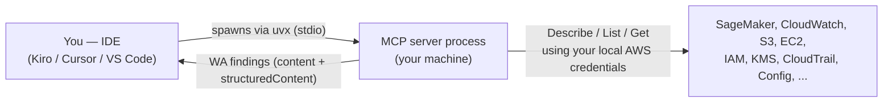
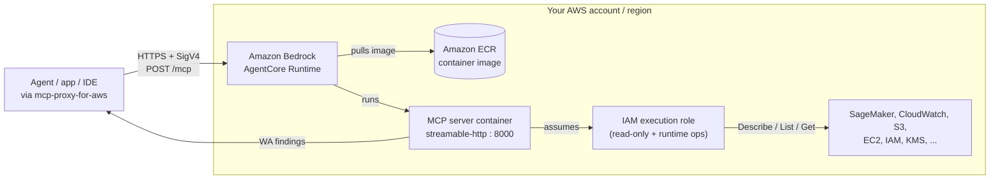

# Well-Architected Review MCP Server for Amazon SageMaker

> **Disclaimer:** Before using this solution, you should consider conducting your own independent assessment to ensure that your use would comply with your own specific security and quality control practices and standards, as well as the laws, rules, and regulations that govern you and your content. In particular, review the IAM execution-role scope, authentication and network mode, and container base-image patching before deployment. All findings and recommendations it produces are advisory and must be independently verified.

## Overview

The Well-Architected Review MCP Server for Amazon SageMaker turns the AWS Well-Architected Framework into tools an AI agent runs against your live SageMaker workloads. Point it at an endpoint, training job, notebook instance, or model — or scan a whole region — and it returns prioritized findings and recommendations across all six pillars (Operational Excellence, Security, Reliability, Performance Efficiency, Cost Optimization, and Sustainability), using read-only AWS APIs.

## Use case

Teams running machine learning on SageMaker are expected to follow AWS best practices — encryption, VPC isolation, autoscaling, checkpointing, cost controls, and more — but reviewing each resource by hand is slow and easy to skip. This server lets an agent do that review on demand:

* **"Is this endpoint production-ready?"** — validate a single resource and get findings by severity, each with a recommended fix.
* **"Audit everything in this region."** — scan all endpoints (or all resource types) and get an aggregated HTML report.
* **"What does the Security pillar check?"** — list the checks behind any pillar.

**Benefits:**

* **50 checks across all six Well-Architected pillars.**
* **Read-only and safe** — only Describe / List / Get calls; no resource is modified.
* **Actionable** — every finding carries a severity and a recommendation.
* **Runs where you work** — locally in your IDE, or hosted on Amazon Bedrock AgentCore for shared/team access.

## Two ways to run

| | Local (IDE) | Hosted (AgentCore) |
|---|---|---|
| **How** | Your IDE spawns the server over stdio | A container running on Amazon Bedrock AgentCore Runtime |
| **Who can use it** | Only you, on that machine | Any authenticated caller with network access to the endpoint |
| **Credentials** | Your local AWS credentials | An IAM execution role attached to the runtime |
| **Best for** | Individual use, quick validation | Shared/team access, integration into a hosted agent |
| **Setup** | [Quickstart](#quickstart) below | [DEPLOYMENT.md](DEPLOYMENT.md) |

## Architecture

The server exposes the same read-only Well-Architected tools over MCP in both modes; only *where the process runs* and *whose credentials it uses* differ.

### Local (IDE over stdio)



Your IDE launches the server as a subprocess. It calls AWS with **your** credentials and returns findings in-process. Nothing is hosted; no network endpoint is exposed.

### Hosted (Amazon Bedrock AgentCore Runtime)



A caller signs each request with SigV4 and POSTs to the runtime's `/mcp` endpoint; AgentCore runs the container (image in Amazon ECR), which assumes a scoped read-only execution role and calls AWS with Describe/List/Get only. Full deployment detail, authentication options (Cognito/JWT), and network modes are in **[DEPLOYMENT.md](DEPLOYMENT.md)**.

## Available Features

### Well-Architected Validation

Provides comprehensive tools for validating SageMaker resources (endpoints, training jobs, notebook instances, and models) against AWS best practices across all six Well-Architected pillars. Each validation returns findings with severity levels and actionable recommendations. See the [validators documentation](well_architected_review_mcp_server_for_sagemaker/README.md) for detailed information on the supported tools.

## Prerequisites

* [Install Python 3.10+](https://www.python.org/downloads/release/python-3100/)
* [Install the `uv` package manager](https://docs.astral.sh/uv/getting-started/installation/)
* [Install and configure the AWS CLI with credentials](https://docs.aws.amazon.com/cli/latest/userguide/cli-chap-configure.html)

## Quickstart

This quickstart guide walks you through the steps to configure the Well-Architected Review MCP Server for Amazon SageMaker for use with Kiro, Cursor, and other compatible IDEs.

| Kiro | Cursor | VS Code |
|:----:|:------:|:-------:|
| [](https://kiro.dev/launch/mcp/add?name=well-architected-review-mcp-server-for-sagemaker&config=%7B%22command%22%3A%22uvx%22%2C%22args%22%3A%5B%22well-architected-review-mcp-server-for-sagemaker%40latest%22%2C%22--allow-sensitive-data-access%22%5D%2C%22env%22%3A%7B%22FASTMCP_LOG_LEVEL%22%3A%22ERROR%22%7D%7D) | [](https://cursor.com/en/install-mcp?name=well-architected-review-mcp-server-for-sagemaker&config=eyJhdXRvQXBwcm92ZSI6W10sImRpc2FibGVkIjpmYWxzZSwiY29tbWFuZCI6InV2eCB3ZWxsLWFyY2hpdGVjdGVkLXJldmlldy1tY3Atc2VydmVyLWZvci1zYWdlbWFrZXJAbGF0ZXN0IC0tYWxsb3ctc2Vuc2l0aXZlLWRhdGEtYWNjZXNzIiwiZW52Ijp7IkZBU1RNQ1BfTE9HX0xFVkVMIjoiRVJST1IifSwidHJhbnNwb3J0VHlwZSI6InN0ZGlvIn0=) | [](https://insiders.vscode.dev/redirect/mcp/install?name=SageMaker%20Well-Architected%20MCP%20Server&config=%7B%22autoApprove%22%3A%5B%5D%2C%22disabled%22%3Afalse%2C%22command%22%3A%22uvx%22%2C%22args%22%3A%5B%22well-architected-review-mcp-server-for-sagemaker%40latest%22%2C%22--allow-sensitive-data-access%22%5D%2C%22env%22%3A%7B%22FASTMCP_LOG_LEVEL%22%3A%22ERROR%22%7D%2C%22transportType%22%3A%22stdio%22%7D) |

**Set up Kiro**

See the [Kiro IDE documentation](https://kiro.dev/docs/mcp/configuration/) or the [Kiro CLI documentation](https://kiro.dev/docs/cli/mcp/configuration/) for details.

For global configuration, edit ~/.kiro/settings/mcp.json. For project-specific configuration, edit .kiro/settings/mcp.json in your project directory.

The example below includes the `--allow-sensitive-data-access` flag for accessing detailed resource configurations:

   **For Mac/Linux:**

	```
	{
	  "mcpServers": {
	    "well-architected-review-mcp-server-for-sagemaker": {
	      "command": "uvx",
	      "args": [
	        "well-architected-review-mcp-server-for-sagemaker@latest",
	        "--allow-sensitive-data-access"
	      ],
	      "env": {
	        "FASTMCP_LOG_LEVEL": "ERROR"
	      },
	      "autoApprove": [],
	      "disabled": false
	    }
	  }
	}
	```

   **For Windows:**

	```
	{
	  "mcpServers": {
	    "well-architected-review-mcp-server-for-sagemaker": {
	      "command": "uvx",
	      "args": [
	        "--from",
	        "well-architected-review-mcp-server-for-sagemaker@latest",
	        "well-architected-review-mcp-server-for-sagemaker.exe",
	        "--allow-sensitive-data-access"
	      ],
	      "env": {
	        "FASTMCP_LOG_LEVEL": "ERROR"
	      },
	      "autoApprove": [],
	      "disabled": false
	    }
	  }
	}
	```

Verify your setup by running the `/tools` command in the Kiro CLI to see the available SageMaker Well-Architected MCP tools.

This server provides comprehensive Well-Architected validation for SageMaker workloads with 50 checks across all six pillars. For broader AWS API access and documentation lookup, you can also use [AWS API MCP Server](https://awslabs.github.io/mcp/servers/aws-api-mcp-server) and [AWS Documentation MCP Server](https://awslabs.github.io/mcp/servers/aws-documentation-mcp-server).

## Configurations

### Arguments

The `args` field in the MCP server definition specifies the command-line arguments passed to the server when it starts. These arguments control how the server is executed and configured. For example:

**For Mac/Linux:**
```
{
  "mcpServers": {
    "well-architected-review-mcp-server-for-sagemaker": {
      "command": "uvx",
      "args": [
        "well-architected-review-mcp-server-for-sagemaker@latest",
        "--allow-sensitive-data-access"
      ],
      "env": {
        "AWS_PROFILE": "your-profile",
        "AWS_REGION": "us-east-1"
      }
    }
  }
}
```

**For Windows:**
```
{
  "mcpServers": {
    "well-architected-review-mcp-server-for-sagemaker": {
      "command": "uvx",
      "args": [
        "--from",
        "well-architected-review-mcp-server-for-sagemaker@latest",
        "well-architected-review-mcp-server-for-sagemaker.exe",
        "--allow-sensitive-data-access"
      ],
      "env": {
        "AWS_PROFILE": "your-profile",
        "AWS_REGION": "us-east-1"
      }
    }
  }
}
```

#### Command Format

The command format differs between operating systems:

**For Mac/Linux:**
* `well-architected-review-mcp-server-for-sagemaker@latest` - Specifies the latest package/version specifier for the MCP client config.

**For Windows:**
* `--from well-architected-review-mcp-server-for-sagemaker@latest well-architected-review-mcp-server-for-sagemaker.exe` - Windows requires the `--from` flag to specify the package and the `.exe` extension.

#### `--allow-sensitive-data-access` (optional)

Enables access to sensitive data such as detailed resource configurations, tags, and endpoint config details. This flag is required for tools that access potentially sensitive information.

* Default: true (Access to sensitive data is allowed by default)
* Example: remove `--allow-sensitive-data-access` from the `args` list in your MCP server definition to disable it.

### Environment variables

The `env` field in the MCP server definition allows you to configure environment variables that control the behavior of the Well-Architected Review MCP Server for Amazon SageMaker. For example:

```
{
  "mcpServers": {
    "well-architected-review-mcp-server-for-sagemaker": {
      "env": {
        "FASTMCP_LOG_LEVEL": "ERROR",
        "AWS_PROFILE": "my-profile",
        "AWS_REGION": "us-west-2"
      }
    }
  }
}
```

#### `FASTMCP_LOG_LEVEL` (optional)

Sets the logging level verbosity for the server.

* Valid values: "DEBUG", "INFO", "WARNING", "ERROR", "CRITICAL"
* Default: "WARNING"
* Example: `"FASTMCP_LOG_LEVEL": "ERROR"`

#### `AWS_PROFILE` (optional)

Specifies the AWS profile to use for authentication.

* Default: None (If not set, uses default AWS credentials).
* Example: `"AWS_PROFILE": "my-profile"`

#### `AWS_REGION` (optional)

Specifies the AWS region where SageMaker resources are validated, which will be used for all AWS service operations.

* Default: None (If not set, uses default AWS region).
* Example: `"AWS_REGION": "us-west-2"`

## Security & Permissions

### Features

The Well-Architected Review MCP Server for Amazon SageMaker implements the following security features:

1. **AWS Authentication**: Uses AWS credentials from the environment for secure authentication.
2. **SSL Verification**: Enforces SSL verification for all AWS API calls.
3. **Least Privilege**: Only requires read/describe/list permissions on SageMaker resources.
4. **User Agent Tracking**: All API calls include a custom user agent for auditability.

### Considerations

When using the Well-Architected Review MCP Server for Amazon SageMaker, consider the following:

* **AWS Credentials**: The server needs permission to describe and list SageMaker resources.
* **Network Security**: Ensure the environment running the server has network access to AWS APIs.
* **Authentication**: Use appropriate authentication mechanisms for AWS resources.
* **Authorization**: Configure IAM with read-only SageMaker permissions.
* **Data Protection**: Resource configurations may contain sensitive information.
* **Logging and Monitoring**: Enable logging and monitoring for SageMaker resources.

### Permissions

The Well-Architected Review MCP Server for Amazon SageMaker performs only read-only operations, which is recommended and considered generally safe for production environments. Below are the tools available:

* **Read-only mode (default)**: `validate_sagemaker_resource`, `validate_all_endpoints`, `validate_all_resources`, `list_sagemaker_resources`, `get_pillar_details`.

#### `autoApprove` (optional)

An array within the MCP server definition that lists tool names to be automatically approved by the MCP Server client, bypassing user confirmation for those specific tools. Since all operations are read-only, auto-approving all tools is safe. For example:

**For Mac/Linux:**
```
{
  "mcpServers": {
    "well-architected-review-mcp-server-for-sagemaker": {
      "command": "uvx",
      "args": [
        "well-architected-review-mcp-server-for-sagemaker@latest"
      ],
      "env": {
        "AWS_PROFILE": "sagemaker-wa-mcp-readonly-profile",
        "AWS_REGION": "us-east-1",
        "FASTMCP_LOG_LEVEL": "INFO"
      },
      "autoApprove": [
        "validate_sagemaker_resource",
        "validate_all_endpoints",
        "validate_all_resources",
        "list_sagemaker_resources",
        "get_pillar_details"
      ]
    }
  }
}
```

**For Windows:**
```
{
  "mcpServers": {
    "well-architected-review-mcp-server-for-sagemaker": {
      "command": "uvx",
      "args": [
        "--from",
        "well-architected-review-mcp-server-for-sagemaker@latest",
        "well-architected-review-mcp-server-for-sagemaker.exe"
      ],
      "env": {
        "AWS_PROFILE": "sagemaker-wa-mcp-readonly-profile",
        "AWS_REGION": "us-east-1",
        "FASTMCP_LOG_LEVEL": "INFO"
      },
      "autoApprove": [
        "validate_sagemaker_resource",
        "validate_all_endpoints",
        "validate_all_resources",
        "list_sagemaker_resources",
        "get_pillar_details"
      ]
    }
  }
}
```

### Role Scoping Recommendations

In accordance with security best practices, we recommend the following:

1. **Create dedicated IAM roles** to be used by the Well-Architected Review MCP Server for Amazon SageMaker with the principle of "least privilege."
2. **Use read-only roles** since the server only performs describe and list operations.
3. **Implement resource tagging** to limit actions to specific resources.
4. **Enable AWS CloudTrail** to audit all API calls made by the server.
5. **Regularly review** the permissions granted to the server's IAM role.
6. **Use IAM Access Analyzer** to identify unused permissions that can be removed.

### Sensitive Information Handling

**IMPORTANT**: Do not pass secrets or sensitive information via allowed input mechanisms:

* Do not include secrets or credentials in tool parameters.
* Do not pass sensitive information directly in the prompt to the model.
* Avoid using MCP tools for creating secrets, as this would require providing the secret data to the model.

**Instead of passing secrets through MCP**:

* Use AWS Secrets Manager or Parameter Store to store sensitive information.
* Configure proper IAM roles for service accounts.
* Use IAM roles for service accounts (IRSA) for AWS service access.

### File System Access

- **Read-Only Operations**: The server does not write to the file system or modify any AWS resources.
- **Host Credentials**: When run locally over stdio, the server uses the host's AWS credentials configuration. When deployed to Amazon Bedrock AgentCore Runtime, it uses the execution role attached to the runtime instead — see [DEPLOYMENT.md](DEPLOYMENT.md) for details.

## Cost

This server is read-only and performs no model inference, so running it on AgentCore costs very little — you pay mainly for AgentCore Runtime compute per validation, plus a few cents of container image storage in Amazon ECR.

| Component | Cost |
|---|---|
| AgentCore Runtime (compute) | ~US$0.0006 per validation run (sub-cent; billed per second on actual CPU/memory consumed) |
| Amazon ECR (image storage) | ~US$0.10/month for the container image (first 500 MB/month free for the first year) |
| Amazon CloudWatch (metric reads) | ~US$0 — the server's metric API calls fall under the Free Tier |
| SageMaker / EC2 / IAM / S3 / etc. reads | US$0 — Describe/List/Get calls are not separately billed |

**Typical monthly cost:**

| Usage | Estimated monthly cost |
|---|---|
| ~100 validations | under US$0.20 |
| ~1,000 validations | under US$1 |
| ~10,000 validations | ~US$6 |

AgentCore microVMs bill per second on actual CPU and memory, and CPU scales to zero while the server waits on AWS API responses — so you only pay for the few active seconds per validation, with no fixed or idle charge.

> **Not included:** the LLM/agent inference cost of whatever model calls these MCP tools is billed separately by your model provider. Figures are illustrative (AgentCore v1 microVM rates) — see [AgentCore pricing](https://aws.amazon.com/bedrock/agentcore/pricing/) and [Amazon ECR pricing](https://aws.amazon.com/ecr/pricing/) for current rates.

## Limitations

- **Advisory only.** Findings and recommendations are heuristics based on read-only API data; they are not a certification and must be independently verified against your own requirements.
- **Read-only by design.** The server never modifies, creates, or deletes resources — it cannot remediate the issues it finds.
- **Amazon SageMaker scope.** It validates SageMaker endpoints, endpoint configs, training jobs, notebook instances, and models — not other AWS services. Related services (CloudWatch, S3, IAM, EC2, KMS, CloudTrail, Config) are read only as needed to evaluate those SageMaker resources.
- **Single region per run.** Each invocation evaluates one AWS region, determined by your configured region/credentials.
- **Point-in-time.** Results reflect configuration and metrics at the moment of the call; this is not continuous monitoring.
- **Not exhaustive.** The ~50 checks across the six Well-Architected pillars are a curated subset, not full coverage of the Well-Architected Framework.
- **Permissions-bound.** Checks degrade if the caller's credentials or execution role lack the required read-only permissions for a given service; grant the documented scope for complete results.
- **No private/VPC-internal probing.** Assessment is based on AWS control-plane configuration and CloudWatch metrics, not in-VPC network reachability or data-plane traffic.

## General Best Practices

* **Resource Naming**: Use descriptive names for SageMaker resources.
* **Error Handling**: Check for errors in tool responses and handle them appropriately.
* **Prioritize Findings**: Address HIGH severity findings first, then MEDIUM, then LOW.
* **Regular Audits**: Run validations periodically to catch configuration drift.
* **Monitoring**: Monitor resource status regularly.
* **Security**: Follow AWS security best practices for SageMaker resources.

## General Troubleshooting

* **Permission Errors**: Verify that your AWS credentials have the necessary read-only SageMaker permissions.
* **Resource Not Found**: Verify the resource name and region are correct.
* **SageMaker API Errors**: Verify that the SageMaker resources exist and are accessible.
* **Network Issues**: Check that the environment has network access to AWS APIs.
* **Client Errors**: Verify that the MCP client is configured correctly.
* **Log Level**: Increase the log level to DEBUG for more detailed logs.

For service-specific issues, consult the relevant documentation:
- [Amazon SageMaker AI Documentation](https://docs.aws.amazon.com/sagemaker/)
- [AWS Well-Architected Framework](https://docs.aws.amazon.com/wellarchitected/latest/framework/welcome.html)

## Version

Current MCP server version: 0.1.0
